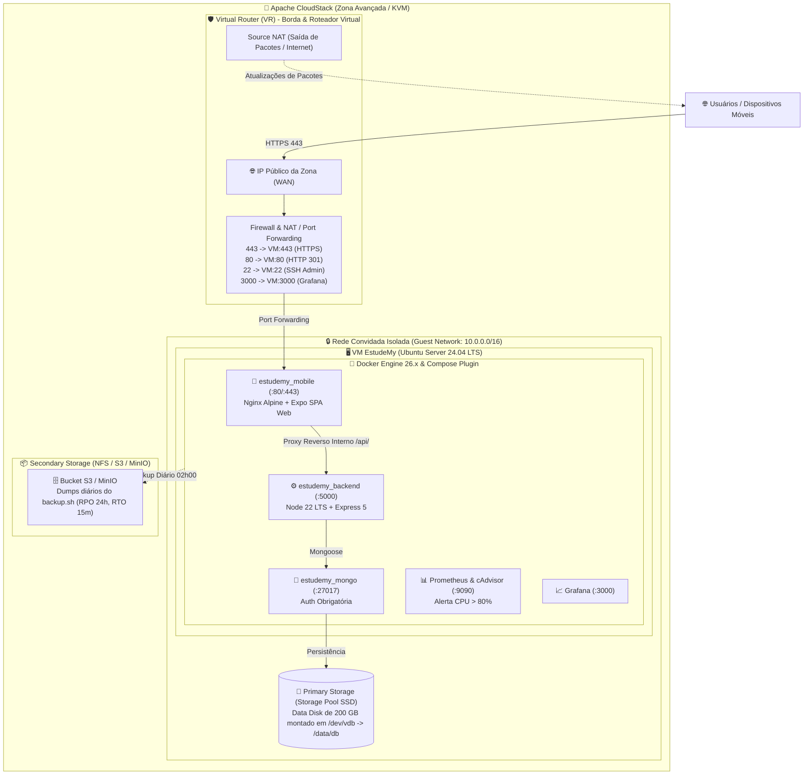

# ☁️ Implementação da Nuvem no Apache CloudStack — EstudeMy

**Projeto Integrador V — Fatec Votorantim**  
**Componente Curricular:** Computação em Nuvem I  
**Professor Responsável:** Prof. Me. Benir Falcão Pistille  
**Escopo:** Nuvem Privada On-Premises com **Apache CloudStack 4.22 LTS (KVM)**  

---

## 📋 Visão Geral da Arquitetura no CloudStack

O **Apache CloudStack** é uma plataforma open-source de orquestração de **Infraestrutura como Serviço (IaaS)** amplamente utilizada em nuvens privadas empresariais e laboratórios acadêmicos da FATEC.

A arquitetura do **EstudeMy** é **100% cloud-agnostic**: toda a lógica da aplicação, banco de dados e observabilidade reside em contêineres Docker padronizados, permitindo que a mesma stack seja executada no CloudStack com paridade absoluta em relação ao OCI Free Tier e AWS.



---

## 1. 🔄 Mapeamento Comparativo: CloudStack vs OCI vs AWS

A tabela a seguir demonstra a correspondência direta entre as primitivas de infraestrutura do Apache CloudStack e os provedores públicos de nuvem:

| Recurso da Arquitetura | Apache CloudStack (Nuvem Privada) | Oracle Cloud (OCI Always Free) | Amazon Web Services (AWS) |
| :--- | :--- | :--- | :--- |
| **Orquestrador IaaS** | Apache CloudStack Management Server | OCI Console & Resource Manager | AWS Management Console & CloudFormation |
| **Hipervisor** | KVM (Kernel-based Virtual Machine) | KVM Gerenciado pela Oracle | AWS Nitro System (KVM Customizado) |
| **Instância / Computação** | **Service Offering:** 4 vCPUs, 24 GB RAM | **Shape:** `VM.Standard.A1.Flex` (ARM) | **Instance Type:** `t4g.2xlarge` |
| **Sistema Operacional** | Template Ubuntu 24.04 LTS (`qcow2`) | Imagem Canônica Ubuntu 24.04 | AMI Oficial Ubuntu 24.04 LTS |
| **Rede Virtual** | **Isolated Guest Network** com Virtual Router | Virtual Cloud Network (VCN) + Subnets | Virtual Private Cloud (VPC) + Subnets |
| **Firewall & Roteamento** | Virtual Router (VR) com Port Forwarding & ACLs | Security Lists & Network Security Groups | Security Groups & Network ACLs |
| **Saída para a Internet** | Source NAT no Virtual Router | NAT Gateway | NAT Gateway / Internet Gateway |
| **Disco do Sistema** | Root Disk (20 GB a 50 GB no Primary Storage) | Boot Volume (50 GB) | EBS gp3 Root Volume |
| **Armazenamento de Dados** | **Disk Offering:** 200 GB SSD (`/dev/vdb`) | Block Volume de 200 GB SSD NVMe | EBS Volume de 200 GB (`gp3`) |
| **Armazenamento de Objetos** | Secondary Storage NFS ou MinIO (S3-compatible) | OCI Object Storage Standard Bucket | Amazon Simple Storage Service (S3) |
| **Automação de Provisionamento** | **Cloud-Init (User Data)** / CloudMonkey CLI | Cloud-Init / OCI CLI / Terraform | Cloud-Init / AWS CLI / Terraform |

---

## 2. 🛠️ Passo a Passo de Implantação no Apache CloudStack

### Passo 1: Criar a Rede Isolada (Isolated Network)
1. Acesse o CloudStack: `Rede (Network) -> Redes de Convidados (Guest Networks)`.
2. Clique em **Adicionar Rede de Convidado (Add Guest Network)**:
   * **Nome:** `estudemy-net`
   * **Zona:** Selecione a Zona padrão (ex.: `Zone-1`).
   * **Oferta de Rede (Network Offering):** `DefaultIsolatedNetworkOfferingWithSourceNATService`.
   * **CIDR do Gateway:** `10.0.1.1` | **Máscara:** `255.255.255.0` (`10.0.1.0/24`).

### Passo 2: Provisionar o Disco de Dados para o MongoDB (200 GB SSD)
1. Acesse `Armazenamento (Storage) -> Volumes`.
2. Clique em **Adicionar Volume**:
   * **Nome:** `estudemy-mongodb-data`
   * **Oferta de Disco (Disk Offering):** `Custom Disk` ou `SSD-200GB`.
   * **Tamanho:** `200 GB`.

### Passo 3: Provisionar a Máquina Virtual (Compute Instance)
1. Acesse `Instâncias (Instances) -> Adicionar Instância (Add Instance)`.
2. **Template:** Escolha o template `Ubuntu Server 24.04 LTS` (formato `qcow2`).
3. **Oferta de Computação (Compute Offering):**
   * Selecione ou crie uma oferta com **4 vCPUs** e **24 GB de Memória RAM** (ou 16 GB).
4. **Rede:** Selecione a rede isolada criada (`estudemy-net`).
5. **Chave SSH:** Selecione ou importe a sua chave pública SSH (`id_rsa.pub` ou `id_ed25519.pub`).
6. **Dados do Usuário (User Data / Cloud-Init):**
   * Cole o conteúdo do script [`cloudstack/user-data.sh`](file:///c:/Users/Alunos/Documents/GitHub/EstudeMy-Mobile/cloudstack/user-data.sh).
   * O Cloud-Init cuidará da instalação do Docker, UFW, formatação e montagem do disco automaticamente!
7. Clique em **Iniciar VM (Launch VM)**.

### Passo 4: Anexar o Disco de 200 GB à Instância
1. Após a criação da VM, acesse `Armazenamento -> Volumes`.
2. Selecione o volume `estudemy-mongodb-data` e clique no ícone **Anexar Disco (Attach Disk)**.
3. Selecione a instância `estudemy-vm` recém-criada. O disco será disponibilizado no Linux como `/dev/vdb`.

### Passo 5: Configurar IP Público, Port Forwarding e Firewall no Virtual Router
Para expor a aplicação de forma segura sem expor a subnet privada:

1. Acesse `Rede -> Redes de Convidados -> estudemy-net -> Endereços IP (IP Addresses)`.
2. Clique no IP Público atribuído pelo Source NAT (ou adquira um novo IP elástico).
3. **Regras de Firewall (Entrada / Ingress):**
   * Porta `80` (TCP) - Origem: `0.0.0.0/0` (HTTP público para redirect).
   * Porta `443` (TCP) - Origem: `0.0.0.0/0` (HTTPS seguro principal).
   * Porta `22` (TCP) - Origem: `IP_DO_ADMINISTRADOR/32` (Acesso SSH restrito).
   * Porta `3000` (TCP) - Origem: `IP_DO_ADMINISTRADOR/32` (Grafana seguro).
4. **Regras de Redirecionamento de Portas (Port Forwarding):**
   * Porta Pública `80`  -> IP Privado da VM : Porta Privada `80` (TCP)
   * Porta Pública `443` -> IP Privado da VM : Porta Privada `443` (TCP)
   * Porta Pública `22`  -> IP Privado da VM : Porta Privada `22` (TCP)
   * Porta Pública `3000`-> IP Privado da VM : Porta Privada `3000` (TCP)

> 🔒 **Garantia de Isolamento:** As portas `5000` (API Backend) e `27017` (MongoDB) **não** recebem regras de Port Forwarding. Elas permanecem 100% isoladas na rede privada da VM e nos contêineres Docker.

---

## 3. 💾 Armazenamento de Objetos (Object Storage) no CloudStack com MinIO

Em nuvens privadas gerenciadas pelo CloudStack, o armazenamento de objetos S3 é implementado através do **MinIO** ou **Ceph RadosGW**:

1. O script de backup [`scripts/backup.sh`](file:///c:/Users/Alunos/Documents/GitHub/EstudeMy-Mobile/scripts/backup.sh) é nativamente compatível com a API AWS S3.
2. Para conectar com o MinIO no CloudStack, basta definir no arquivo `.env`:
   ```env
   OBJECT_STORAGE_PROVIDER=aws
   AWS_ACCESS_KEY_ID=minioadmin
   AWS_SECRET_ACCESS_KEY=minioadmin_senha_forte_2026
   AWS_DEFAULT_REGION=us-east-1
   AWS_ENDPOINT_URL=http://minio.cloudstack.local:9000
   OBJECT_STORAGE_BUCKET=estudemy-backups
   ```
3. A rotina diária às **02h00** (`0 2 * * *`) enviará os dumps compactados diretamente para o cluster MinIO, cumprindo o **RPO de 24h** e o **RTO de 15m**.

---

## 4. ⚡ Automação via CLI do CloudStack (CloudMonkey - `cmk`)

Caso a equipe opte por provisionar a infraestrutura via linha de comando no terminal do laboratório:

```bash
# 1. Configurar credenciais do CloudMonkey
cmk set url http://cloudstack-management.fatec.br:8080/client/api
cmk set apikey SUA_API_KEY
cmk set secretkey SUA_SECRET_KEY

# 2. Deploy da Máquina Virtual no CloudStack
cmk deploy virtualmachine \
    serviceofferingid="4-core-24gb-ram-uuid" \
    templateid="ubuntu-24-04-lts-uuid" \
    zoneid="zone-fatec-uuid" \
    networkids="estudemy-net-uuid" \
    name="estudemy-production-vm" \
    keypair="chave-fatec" \
    userdata="$(base64 -w 0 cloudstack/user-data.sh)"

# 3. Criar e Anexar Volume de 200 GB
cmk create volume name=estudemy-mongo-data diskofferingid="ssd-disk-uuid" size=200 zoneid="zone-fatec-uuid"
cmk attach volume id="volume-uuid" virtualmachineid="vm-uuid"
```

---

## 5. ✅ Validação Final do Ambiente no CloudStack

Após a inicialização da VM e da stack de contêineres:

```bash
# Conectar via SSH na VM através do IP Público do Virtual Router
ssh -i ~/.ssh/id_rsa ubuntu@IP_PUBLICO_VR

# Entrar no diretório da aplicação
cd /opt/estudemy

# Subir a stack de produção com Docker Compose
npm run docker:prod

# Executar a bateria de testes de validação em nuvem
npm run cloud:test
```

O script testará automaticamente a conectividade da SPA web (80/443), o healthcheck da API Backend, a persistência do MongoDB no disco `/dev/vdb` e os coletores de métricas do Prometheus e Grafana.
