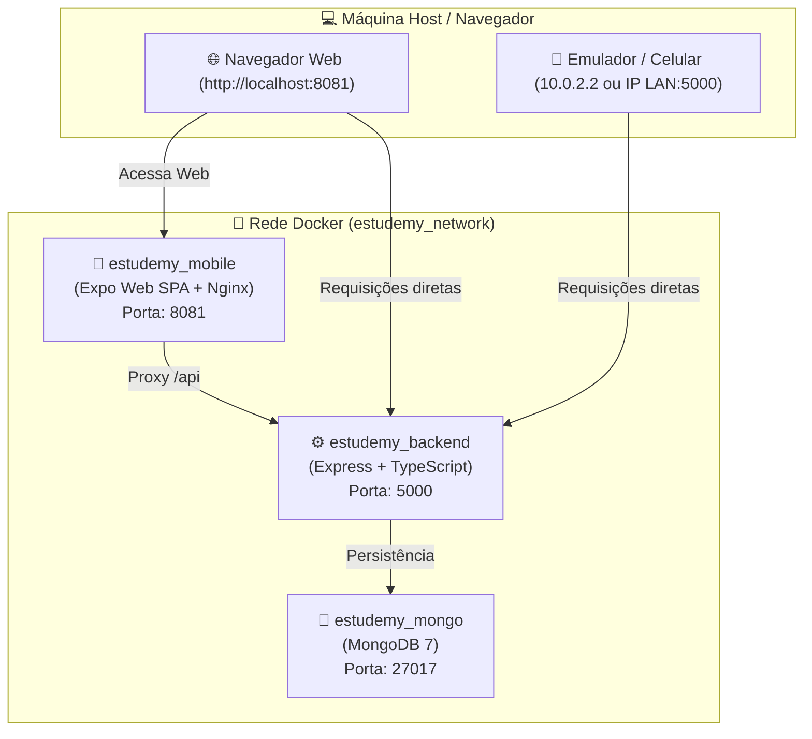

# 🐳 Integração Docker - EstudeMy Mobile & Backend

Este guia orienta como executar a stack completa do **EstudeMy** em contêineres Docker, unindo o **Aplicativo Mobile (Expo Web / Nginx)**, a **API Backend (Node.js + Express + TypeScript)** e o banco de dados **MongoDB**.

---

## 🏗️ Arquitetura da Solução

O ambiente orquestrado via `docker-compose.yml` isola e conecta os três componentes essenciais:



---

## 📦 Serviços Orquestrados

| Serviço | Contêiner | Porta Mapeada | Descrição |
| :--- | :--- | :--- | :--- |
| **mongo** | `estudemy_mongo` | `27017:27017` | Banco de dados NoSQL oficial com volume persistente. |
| **backend** | `estudemy_backend` | `5000:5000` | API REST em Node.js / Express a partir de `../EstudeMy-BackEnd-TS`. |
| **mobile** | `estudemy_mobile` | `8081:80` | Aplicativo compilado estaticamente servido via **Nginx** de alta performance. |

---

## 🚀 Como Executar

### 1. Pré-requisitos
*   [Docker Desktop](https://www.docker.com/products/docker-desktop/) instalado e em execução no Windows.
*   Os repositórios `EstudeMy-Mobile` e `EstudeMy-BackEnd-TS` posicionados lado a lado no diretório GitHub:
    ```text
    GitHub/
    ├── EstudeMy-BackEnd-TS/
    └── EstudeMy-Mobile/
    ```

### 2. Configurar Variáveis de Ambiente (Opcional)
Se desejar personalizar portas ou senhas, crie o arquivo `.env.compose` a partir do modelo:
```bash
cp docker-compose.env.example .env.compose
```

### 3. Subir a Stack Completa (Produção Web)
Para construir as imagens e iniciar os serviços:
```bash
docker compose up --build
```
> Ou utilize o atalho configurado no `package.json`:
> ```bash
> npm run docker:up
> ```

Acesse no seu navegador:
*   **App Mobile Web:** [http://localhost:8081](http://localhost:8081)
*   **Backend API:** [http://localhost:5000](http://localhost:5000)
*   **Documentação Swagger:** [http://localhost:5000/api-docs](http://localhost:5000/api-docs)

---

## 🛠️ Modo Desenvolvimento com Hot Reload (Metro Bundler)

Caso queira rodar o servidor de desenvolvimento do Expo com atualização em tempo real dentro do Docker:

```bash
docker compose -f docker-compose.yml -f docker-compose.dev.yml up --build
```
> Ou pelo atalho:
> ```bash
> npm run docker:dev
> ```

---

## 📱 Conexão a partir de Dispositivos Móveis e Emuladores

Ao rodar o aplicativo nativamente via Expo Go ou emulador e querer apontar para o backend Docker:

1.  **Emulador Android (Android Studio):**
    *   No arquivo `.env` do mobile, configure:
        ```env
        EXPO_PUBLIC_API_URL=http://10.0.2.2:5000
        ```
2.  **Dispositivo Físico (Mesma rede Wi-Fi):**
    *   Descubra o IP da sua máquina no Windows executando `ipconfig` (ex: `192.168.1.15`).
    *   No arquivo `.env` do mobile, configure:
        ```env
        EXPO_PUBLIC_API_URL=http://192.168.1.15:5000
        ```
3.  **Ambiente Docker Web:**
    *   O Nginx já possui proxy reverso configurado para repassar chamadas de `/api/` diretamente ao contêiner `backend:5000`.

---

## 📋 Comandos Úteis

| Ação | Comando Docker | Atalho NPM |
| :--- | :--- | :--- |
| **Construir imagens** | `docker compose build` | `npm run docker:build` |
| **Iniciar em segundo plano** | `docker compose up -d` | `npm run docker:up` |
| **Visualizar logs** | `docker compose logs -f` | `npm run docker:logs` |
| **Parar todos os contêineres** | `docker compose down` | `npm run docker:down` |
| **Limpar volumes (resetar banco)**| `docker compose down -v` | - |
