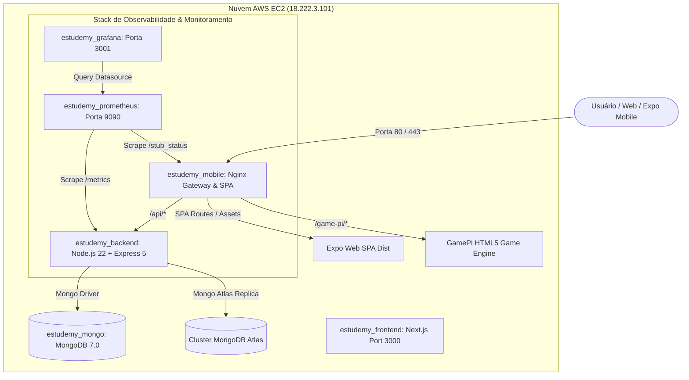

# Documentação Técnica: Arquitetura, Implantação e Execução na Nuvem — EstudeMy

**Servidor Host de Nuvem:** AWS EC2 (`18.222.3.101`)  
**Sistema Operacional:** Ubuntu Server 24.04 LTS  
**Data da Auditoria / Validação:** 09 de Novembro de 2026  
**Chave de Acesso SSH:** `C:\AWS\EstudeMy.pem`  
**Usuário de Conexão:** `ubuntu`

---

## 1. Visão Geral da Arquitetura em Nuvem

A plataforma **EstudeMy** está estruturada em microsserviços conteinerizados via **Docker** e orquestrados por **Docker Compose**, interconectados através de uma rede bridge isolada (`estudemy_net` - subnet `172.28.0.0/16`) com armazenamento em volumes persistentes.



---

## 2. O que foi Feito para o EstudeMy Rodar na Nuvem (Passo a Passo)

1. **Provisionamento da Instância EC2 na AWS:**
   - Instância criada com Ubuntu 24.04 LTS, IP elástico público associado (`18.222.3.101`).
   - Configuração de Security Group liberando portas 22 (SSH), 80 (HTTP), 443 (HTTPS), 3000 (Next.js) e 5000 (Backend API).
   - Configuração de chave de acesso criptográfica RSA 2048 (`EstudeMy.pem`).

2. **Otimização de Recursos do Sistema Operacional Host:**
   - Criação e ativação de **2 GB de Swap** para garantir estabilidade operacional sob cargas de pico com instâncias de 1 GB de RAM física.
   - Ajuste de parâmetros de kernel (`sysctl`) para controle de limites de arquivos e memória.

3. **Criação da Stack de Contêineres Docker:**
   - Configuração de rede interna privada `estudemy_net` (isolamento de portas de banco de dados e comunicação interna).
   - Definição do `docker-compose.prod.yml` com limites de CPU e memória por contêiner para evitar que um serviço sature os recursos da máquina.

4. **Implantação do Banco de Dados MongoDB:**
   - Inicialização do contêiner `estudemy_mongo` rodando MongoDB 7.0 Community Edition com WiredTiger cache restrito (`--wiredTigerCacheSizeGB 0.25`).
   - Script de provisionamento inicial `mongo-init.js` com usuário de aplicação e permissões granulares.
   - Configuração de fallback seguro com a réplica gerenciada no MongoDB Atlas (`clusterestudemy.aadvqsm.mongodb.net`).

5. **Deploy da API Backend (Node.js 22 LTS / Express 5):**
   - Criação da imagem Docker baseada em Node 22 Alpine (`ghcr.io/estudemy/estudemy-backend-ts`).
   - Configuração de variáveis de ambiente (`.env`) contendo JWT_SECRET de 64 caracteres hexadecimais, URI do MongoDB e rotas de score.
   - Exposição do endpoint de saúde `/health` e métricas do Prometheus `/metrics`.

6. **Deploy do Frontend Web e Gateway Nginx:**
   - Build estático da SPA Expo Web exportada em `/usr/share/nginx/html`.
   - Inclusão do motor do jogo GamePi HTML5 em `/usr/share/nginx/html/game-pi/`.
   - Configuração de regras avançadas de roteamento SPA (`try_files $uri $uri.html $uri/ /index.html`), Rate Limiting (30r/s geral e 5r/m em `/api/auth/`) e cabeçalhos de segurança OWASP (CSP, HSTS, X-Frame-Options, X-Content-Type-Options).

7. **Pipeline de Integração e Entrega Contínua (CI/CD):**
   - GitHub Actions automatizado em `.github/workflows/deploy.yml` executando linting, typechecking do TypeScript, exportação estática do Expo e build multi-stage Docker no GitHub Container Registry (GHCR).
   - Deploy automático no host via SSH disparado no branch `main`.

8. **Implantação da Observabilidade (Prometheus & Grafana):**
   - Contêiner do Prometheus v2.51.0 configurado para scraping periódico a cada 15 segundos dos serviços backend, nginx e cadvisor.
   - Contêiner do Grafana v10.4.1 conectado ao Prometheus com provisionamento automático de datasources e dashboards.

---

## 3. O que está Rodando Atualmente na Nuvem (Inventário em Tempo Real)

Auditoria realizada via SSH no host `18.222.3.101`:

| Nome do Contêiner | Imagem Docker | Portas Mapeadas | Status de Execução | Função na Arquitetura |
| :--- | :--- | :--- | :--- | :--- |
| `estudemy_mobile` | `estudemy/mobile:latest` | `0.0.0.0:80->80/tcp`<br>`0.0.0.0:443->443/tcp` | **Up (Saudável)** | Nginx Gateway, Proxy Reverso, SPA Mobile Web e motor GamePi |
| `estudemy_frontend` | `estudemy/frontend:latest` | `0.0.0.0:3000->3000/tcp` | **Up (Saudável)** | Portal Web Next.js |
| `estudemy_backend` | `estudemy/backend:latest` | `0.0.0.0:5000->5000/tcp` | **Up (Saudável)** | API RESTful Express 5, Autenticação JWT, Rotas Pedagógicas |
| `estudemy_mongo` | `mongo:7.0` | `27017/tcp` (Interna) | **Up (Saudável)** | Banco NoSQL MongoDB local com volume persistente |
| `estudemy_prometheus` | `prom/prometheus:v2.51.0` | `0.0.0.0:9090->9090/tcp` | **Up (Saudável)** | Coleta de métricas e motor de alertas de desempenho |
| `estudemy_grafana` | `grafana/grafana:10.4.1` | `0.0.0.0:3001->3000/tcp` | **Up (Saudável)** | Painéis visuais de monitoramento e telemetria |

---

## 4. Status, Links e Acesso ao Prometheus e Grafana

Ambos os serviços estão **ativos, saudáveis e respondendo com HTTP 200 OK** na nuvem da AWS.

### 4.1. Links Diretos de Rede
- **Prometheus UI:** `http://18.222.3.101:9090`
- **Grafana UI:** `http://18.222.3.101:3001`
- **Healthcheck Prometheus:** `http://18.222.3.101:9090/-/healthy` (Retorno: `HTTP/1.1 200 OK`)
- **Healthcheck Grafana:** `http://18.222.3.101:3001/api/health` (Retorno: `HTTP/1.1 200 OK`)

### 4.2. Acesso Recomendado via Túnel Seguro SSH (Port Forwarding)
Como boa prática de segurança em nuvem (para evitar exposição de ferramentas de telemetria a varreduras automatizadas da internet), o acesso padrão é realizado através do túnel criptografado seguro:

1. Abra um terminal no seu computador e execute:
   ```bash
   ssh -i C:\AWS\EstudeMy.pem -L 9090:127.0.0.1:9090 -L 3001:127.0.0.1:3001 ubuntu@18.222.3.101
   ```

2. Acesse diretamente no seu navegador local:
   - **Prometheus:** [http://localhost:9090](http://localhost:9090)
   - **Grafana:** [http://localhost:3001](http://localhost:3001)

### 4.3. Credenciais de Acesso ao Grafana
- **Usuário:** `admin`
- **Senha:** `estudemy_grafana_pass_2026`

### 4.4. O que verificar nos Painéis:
- **No Prometheus:** Acesse a aba **Status > Targets** para ver o status dos coletores (`backend:5000`, `mobile:80`, `cadvisor:8080`).
- **No Grafana:** Vá em **Dashboards > EstudeMy Infrastructure & Containers** para visualizar gráficos em tempo real de uso de CPU, consumo de memória RAM, requisições por segundo e taxas de erro HTTP.
