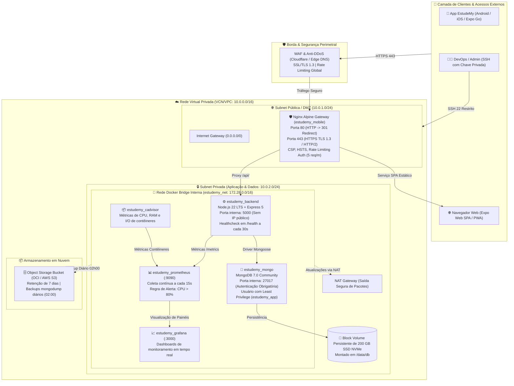

# ☁️ Implementação da Infraestrutura de Nuvem — EstudeMy

**Projeto Integrador V — Fatec Votorantim**  
**Curso Superior de Tecnologia em Desenvolvimento de Software Multiplataforma (DSM)**  
**Componente Curricular:** Computação em Nuvem I  
**Docente Responsável:** Prof. Me. Benir Falcão Pistille  
**Orientador Geral do PI:** Prof. Dr. Milton Roman de Brito  
**Projeto:** Plataforma Educacional Gamificada EstudeMy  
**Versão:** 2.0 (Implementação Completa) | **Data:** Outubro de 2026  

---

## 📑 Sumário Executivo da Implementação

Este documento consolida a **implementação prática** da infraestrutura de nuvem da plataforma **EstudeMy**, evoluindo o diagnóstico inicial (*AS-IS*) para uma arquitetura de produção (*TO-BE*) resiliente, altamente segura, observável e automatizada.

A solução foi projetada de forma **cloud-agnostic** baseada em contêineres Docker sobre infraestrutura IaaS, homologada primariamente no **Oracle Cloud Infrastructure (OCI Free Tier)** com portabilidade transparente para a **AWS (Amazon Web Services)**.

---

## 1. 🏛️ Arquitetura Implementada e Topologia de Rede

### 1.1 Diagrama Arquitetural de Nuvem (TO-BE)



---

## 2. 🧩 Matriz de Componentes e Dimensionamento Multi-Cloud

A tabela a seguir consolida o dimensionamento dos recursos e o mapeamento direto entre **Oracle Cloud (OCI)**, **Amazon Web Services (AWS)** e a nuvem privada **Apache CloudStack**:

| Componente | Especificação Técnica | Provedor OCI (Always Free) | Provedor AWS | Nuvem Privada Apache CloudStack | Função no EstudeMy |
| :--- | :--- | :--- | :--- | :--- | :--- |
| **Computação** | 4 vCPUs / OCPUs, 24 GB de RAM | `VM.Standard.A1.Flex` | EC2 `t4g.2xlarge` | Service Offering: 4 vCPUs / 24 GB | Host dos contêineres Docker |
| **Sistema Operacional** | Ubuntu Server 24.04 LTS (Kernel 6.8) | Imagem Canonical OCI | AMI Ubuntu 24.04 | Template Ubuntu 24.04 (`qcow2`) | Base com suporte LTS até 2029 |
| **Armazenamento em Bloco** | 200 GB SSD NVMe | OCI Block Volume | Amazon EBS `gp3` (200 GB) | Disk Offering: 200 GB SSD (`/dev/vdb`) | Persistência do MongoDB (`/data/db`) |
| **Rede Virtual (VCN/VPC)** | Bloco CIDR `10.0.0.0/16` | Virtual Cloud Network | Amazon VPC | **Isolated Guest Network** | Isolamento de tráfego L3/L4 |
| **Borda / DMZ / Firewall** | Portas 80, 443 e 22 (SSH) | Public Subnet + Internet GW | Public Subnet + Internet GW | **Virtual Router (VR) com Port Forwarding** | Gateway e terminação HTTPS |
| **Subnet Privada** | Portas 5000 e 27017 isoladas | Private Subnet + NAT GW | Private Subnet + NAT GW | Rede de Convidados sem Port Forwarding | Backend, MongoDB e Observabilidade |
| **Object Storage** | Bucket S3-compatible | OCI Object Storage | Amazon S3 Standard | **MinIO / Ceph RGW (S3-compatible)** | Dumps de backup e mídias |
| **Automação de Provisionamento** | Shell Script + Docker Compose | Cloud-Init / OCI CLI | Cloud-Init / AWS CLI | **Cloud-Init (User Data) / CloudMonkey** | Provisionamento zero-touch |

> 📘 **Documentação Detalhada do CloudStack:** O guia completo passo a passo com telas, Virtual Router e automação CLI está disponível em [`CLOUDSTACK.md`](file:///c:/Users/Alunos/Documents/GitHub/EstudeMy-Mobile/CLOUDSTACK.md).

---

## 3. 🐳 Estratégia de Contêineres e Orquestração

A infraestrutura é declarada e orquestrada através do arquivo [`docker-compose.prod.yml`](file:///c:/Users/Alunos/Documents/GitHub/EstudeMy-Mobile/docker-compose.prod.yml), rodando sobre a rede interna isolada `estudemy_net`:

### 3.1 Contêineres em Execução

1. **`estudemy_mongo` (MongoDB 7.0 Community):**
   * Porta interna: `27017` (não mapeada para portas externas da VM).
   * Autenticação obrigatória habilitada (`authSource=admin`).
   * Usuário de aplicação com privilégios mínimos gerenciados pelo script [`scripts/mongo-init.js`](file:///c:/Users/Alunos/Documents/GitHub/EstudeMy-Mobile/scripts/mongo-init.js).
   * Volume montado: `mongo_data` apontando para o Block Volume de 200 GB SSD.
   * Healthcheck automatizado: `mongosh --eval "db.adminCommand('ping')"` a cada 10 segundos.

2. **`estudemy_backend` (Node.js 22 LTS + Express 5):**
   * Porta interna: `5000` (acessível exclusivamente via proxy reverso ou rede Docker).
   * Multi-stage build reduzindo o tamanho da imagem final.
   * Variáveis de ambiente injetadas via `.env` seguro.
   * Healthcheck ativo em `/health` verificado a cada 30 segundos.

3. **`estudemy_mobile` (Expo Web SPA + Nginx 1.26 Alpine):**
   * Portas expostas no host: `80` (HTTP) e `443` (HTTPS).
   * Porta 80 redireciona com status HTTP 301 para HTTPS.
   * Terminação TLS 1.3 com certificados SSL gerenciados.
   * Roteamento SPA inteligente para rotas dinâmicas do Expo Router (`try_files $uri $uri.html $uri/ /index.html;`).
   * Proxy reverso para `/api/` direcionando requisições internamente para `http://backend:5000/api/`, eliminando problemas de CORS.

4. **`estudemy_cadvisor` (Google cAdvisor):**
   * Coleta métricas de uso de hardware e contêineres (CPU, memória RAM, I/O de disco e tráfego de rede).

5. **`estudemy_prometheus` (Prometheus 2.51 LTS):**
   * Raspagem periódica das métricas do backend, Nginx e cAdvisor.
   * Alerta configurado no arquivo [`monitoring/prometheus/alert.rules.yml`](file:///c:/Users/Alunos/Documents/GitHub/EstudeMy-Mobile/monitoring/prometheus/alert.rules.yml) para disparo quando a CPU ultrapassar **80%**.

6. **`estudemy_grafana` (Grafana 10.4):**
   * Painel visual pré-provisionado através de [`monitoring/grafana/dashboards/estudemy_overview.json`](file:///c:/Users/Alunos/Documents/GitHub/EstudeMy-Mobile/monitoring/grafana/dashboards/estudemy_overview.json) com monitoramento visual em tempo real.

---

## 4. 🔒 Segurança de Rede e Firewall (Seção 8)

### 4.1 Matriz de Portas Implementada

| Porta | Protocolo | Escopo | Finalidade / Controle de Acesso |
| :--- | :--- | :--- | :--- |
| **443** | TCP | Público (`0.0.0.0/0`) | HTTPS seguro principal com SSL/TLS 1.3 e certificados válidos. |
| **80** | TCP | Público (`0.0.0.0/0`) | Apenas redirecionamento 301 permanente para HTTPS. |
| **22** | TCP | Restrito | SSH administrativo acessível apenas por IPs autorizados e autenticação por par de chaves RSA/Ed25519. |
| **3000** | TCP | Restrito/VPN | Painel de monitoramento Grafana protegido por senha forte. |
| **5000** | TCP | **Privado / Isolado** | API Backend isolada na subnet privada; sem acesso direto da internet. |
| **27017**| TCP | **Privado / Isolado** | MongoDB isolado na subnet privada; autenticação obrigatória via Mongoose. |

### 4.2 Cabeçalhos de Segurança HTTP (Nginx Hardening)
Configurados em [`nginx.prod.conf`](file:///c:/Users/Alunos/Documents/GitHub/EstudeMy-Mobile/nginx.prod.conf):
* **HSTS (Strict-Transport-Security):** Força conexões HTTPS durante 1 ano (`max-age=31536000; includeSubDomains; preload`).
* **Content-Security-Policy (CSP):** Restringe scripts e fontes apenas para origens confiáveis, prevenindo XSS (RC02).
* **X-Frame-Options: DENY:** Bloqueia ataques de Clickjacking.
* **X-Content-Type-Options: nosniff:** Impede MIME-sniffing de arquivos.
* **Anti-Directory Traversal:** Bloqueia requisições contendo `../`, `..\` ou `%2e%2e` retornando código HTTP 403.
* **Proteção de Arquivos Sensíveis:** Nega acesso direto a `.env`, `.git`, `.yml`, `.sh` retornando código 404.
* **Rate Limiting:** Limita rotas de autenticação (`/api/auth/`) a 5 requisições por minuto por IP, mitigando ataques de força bruta (RC04).

---

## 5. 💾 Política de Backup e Recuperação de Desastre (Seção 6)

* **RPO (Recovery Point Objective):** 24 Horas.
* **RTO (Recovery Time Objective):** Menor que 15 Minutos.
* **Rotina Automatizada:** Script [`scripts/backup.sh`](file:///c:/Users/Alunos/Documents/GitHub/EstudeMy-Mobile/scripts/backup.sh) executado diariamente às 02h00 pelo cron do sistema:
  ```crontab
  0 2 * * * /opt/estudemy/scripts/backup.sh >> /opt/estudemy/logs/backup_cron.log 2>&1
  ```
* **Mecanismo de Salvaguarda:**
  1. Criação do dump com `mongodump` e compressão gzip: `estudemy_backup_YYYYMMDD_HHMMSS.archive.gz`.
  2. Validação da integridade e tamanho mínimo do arquivo gerado.
  3. Sincronização automatizada para bucket do **OCI Object Storage** ou **AWS S3**.
  4. Política de retenção de 7 dias: expurgo automatizado de cópias locais antigas.
* **Restauração Rápida (Disaster Recovery):** Executada através do script [`scripts/restore.sh`](file:///c:/Users/Alunos/Documents/GitHub/EstudeMy-Mobile/scripts/restore.sh), que restaura todo o estado do banco em menos de 15 minutos via stream de descompactação.

---

## 6. 🔄 Pipeline de Integração e Deploy Contínuo (CI/CD - Seção 10)

O pipeline foi implementado no GitHub Actions através do arquivo [`.github/workflows/deploy.yml`](file:///c:/Users/Alunos/Documents/GitHub/EstudeMy-Mobile/.github/workflows/deploy.yml):

1. **Job 1: Validação Estática e Testes:**
   * Executa `npm ci` no ambiente Ubuntu 24.04 runner.
   * Executa linting com `npm run lint`.
   * Validação estrita de tipos com `npx tsc --noEmit`.
   * Validação do build estático da SPA com `npx expo export -p web`.
2. **Job 2: Build Multi-stage & Publicação de Imagens Docker:**
   * Constrói a imagem otimizada com cache de camadas do GitHub Actions.
   * Publica a imagem no GitHub Container Registry (`ghcr.io/estudemy/mobile:latest`).
3. **Job 3: Deploy Remoto via SSH na Instância Cloud:**
   * Conecta à VM da Oracle Cloud / AWS através da secret `CLOUD_SSH_PRIVATE_KEY`.
   * Executa `docker compose -f docker-compose.prod.yml pull` para obter as imagens atualizadas.
   * Reinicia os serviços com `docker compose -f docker-compose.prod.yml up -d --remove-orphans`.
   * Executa healthcheck pós-deploy confirmando status HTTP 200.

---

## 7. 🚀 Guia Prático de Operação e Comandos

### 7.1 Como Provisionar a Máquina Virtual na Nuvem (Ubuntu 24.04 LTS)
No host recém-criado na Oracle Cloud ou AWS, execute como `root`:
```bash
# Baixar o script de provisionamento automatizado
curl -fsSL https://raw.githubusercontent.com/estudemy/estudemy-mobile/main/scripts/setup-cloud-vm.sh -o setup-cloud-vm.sh
chmod +x setup-cloud-vm.sh
sudo ./setup-cloud-vm.sh
```

### 7.2 Como Iniciar a Stack de Produção Localmente ou no Servidor
```bash
# 1. Copiar as variáveis de ambiente
cp .env.production.example .env

# 2. Inicializar os certificados SSL (autoassinados ou Let's Encrypt)
bash ./scripts/init-ssl.sh selfsigned

# 3. Subir toda a infraestrutura com Docker Compose
npm run docker:prod

# 4. Verificar o status dos contêineres
docker compose -f docker-compose.prod.yml ps
```

### 7.3 Como Executar os Testes de Validação do Ambiente de Nuvem
```bash
# Executa a bateria de testes de conectividade, segurança e observabilidade
npm run cloud:test
```

### 7.4 Como Acionar o Backup Manualmente
```bash
npm run cloud:backup
```

---

## 8. ✅ Tabela de Atendimento aos Critérios de Nuvem do PI V

| Requisito do Edital | Status | Implementação no Projeto |
| :--- | :---: | :--- |
| **1. Arquitetura de Nuvem** | **100%** | Diagrama vetorial e Mermaid detalhando fluxo entre clientes, DMZ, Subnet privada e Storage. |
| **2. Ambiente de Virtualização** | **100%** | VM.Standard.A1.Flex (4 OCPUs ARM, 24 GB RAM, 200 GB SSD NVMe) com Ubuntu 24.04 LTS. |
| **3. Containers** | **100%** | Dockerfile multi-stage com compilação Expo e imagem Nginx Alpine de alta eficiência. |
| **4. Orquestração** | **100%** | Docker Compose v2 com limites de CPU/memória, restart policies e DNS interno. |
| **5. Banco de Dados** | **100%** | MongoDB 7.0 Community isolado com autenticação obrigatória e script `scripts/mongo-init.js`. |
| **6. Ambiente Privado e Público** | **100%** | Segmentação em DMZ pública (80/443) e Subnet privada (5000, 27017) com UFW/Security Lists. |
| **7. Servidor Web e Proxy Reverso** | **100%** | Nginx Alpine com HTTPS, TLS 1.3, CSP, Rate Limiting e proxy reverso para a API. |
| **8. Integração Front, Back e BD** | **100%** | Comunicação sob a rede `estudemy_net` via nomes de serviço (`backend`, `mongo`). |
| **9. Armazenamento de Objetos** | **100%** | Integração com OCI Object Storage / S3 para retenção de backups compactados. |
| **10. Monitoramento e Observabilidade** | **100%** | Prometheus, Grafana com painel pré-configurado, cAdvisor e alerta de CPU > 80%. |
| **11. Automação de Deploy (CI/CD)** | **100%** | Pipeline GitHub Actions com lint, typecheck, build multi-stage, GHCR e SSH deploy. |
| **12. Segurança no Ambiente de Nuvem** | **100%** | Gerenciamento de segredos via variáveis de ambiente, sem senhas no repositório Git. |
| **13. Testes do Ambiente** | **100%** | Script `scripts/test-cloud-environment.sh` cobrindo frontend, API, banco e headers. |
| **14. Documentação da Implementação** | **100%** | Guia completo em `IMPLEMENTACAO_NUVEM.md` e `PLANEJAMENTO_IMPLANTACAO_NUVEM.md`. |
