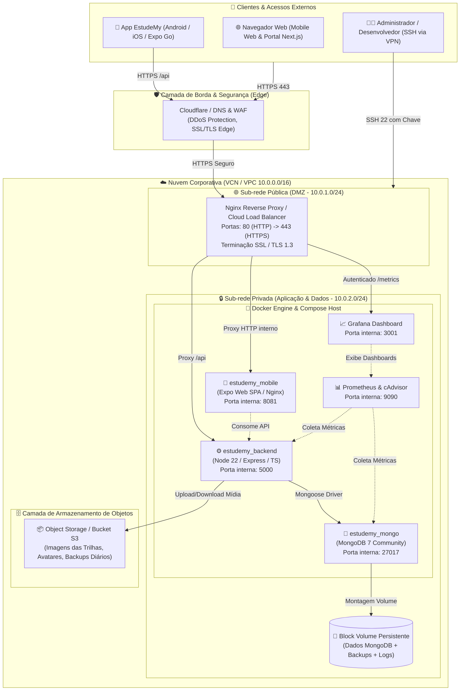
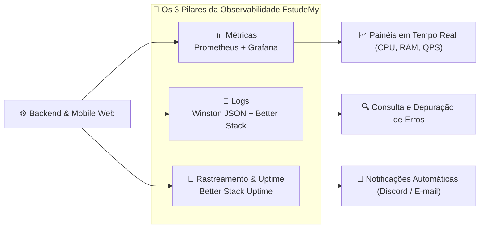
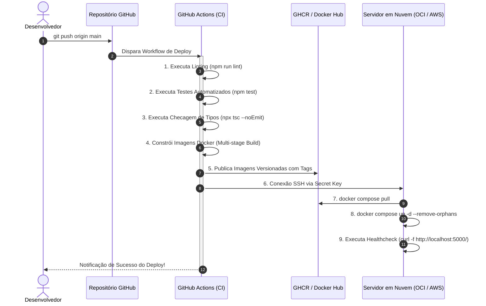

# ☁️ Planejamento e Análise do Ambiente de Nuvem (Entrega 1 - PI V)

**Projeto Integrador V — Fatec Votorantim**  
**Curso Superior de Tecnologia em Desenvolvimento de Software Multiplataforma (DSM)**  
**Disciplina-Satélite:** Computação em Nuvem I  
**Docente Responsável:** Prof. Me. Benir Falcão Pistille  
**Orientador Geral do PI:** Prof. Dr. Milton Roman de Brito  
**Projeto:** Plataforma Educacional Gamificada EstudeMy  
**Data:** Outubro de 2026 | **Versão:** 1.0  

---

## 📋 Sumário Executivo

Este documento apresenta o planejamento arquitetural e a análise do ambiente de computação em nuvem para a plataforma **EstudeMy**, atendendo rigorosamente aos critérios estabelecidos para a **Entrega 1 (até 20/10)** da disciplina de Computação em Nuvem I.

O planejamento contempla:
1. Diagnóstico da situação atual do projeto (*AS-IS*).
2. Arquitetura proposta para nuvem (*TO-BE*).
3. Componentes de infraestrutura, ambientes de execução e estratégias de virtualização e conteinerização.
4. Topologia do banco de dados e rotinas de salvaguarda.
5. Estratégias de entrega de Frontend e Backend.
6. Mecanismos de rede, segmentação e segurança perimetral.
7. Estrutura de monitoramento e observabilidade em três pilares.
8. Pipeline automatizado de deploy contínuo (CI/CD).
9. Cronograma e plano de alterações para a Entrega 2 (17/11).

---

## 1. 🔍 Diagnóstico da Situação Atual do Projeto (Cenário *AS-IS*)

### 1.1 Contexto e Estrutura dos Repositórios
A solução EstudeMy é composta por três módulos principais:
*   **EstudeMy-Mobile:** Aplicativo móvel construído em **React Native** com **Expo SDK 57**, navegação baseada em arquivos via **Expo Router**, componentes SVG/Lucide e versão web compilada em SPA.
*   **EstudeMy-BackEnd-TS:** API RESTful em **Node.js 22 + Express 5** escrita em **TypeScript**, autenticação JWT, hashing de senhas com Bcrypt e validação de requisições.
*   **EstudeMy-FrontEnd-TS:** Portal web administrativo e de aprendizagem em **Next.js 15 (React 19)**.

### 1.2 Infraestrutura e Execução Atual
*   **Ambiente Local:** O desenvolvimento é realizado com ferramentas locais (Node.js, npm, Expo CLI) e orquestração local via Docker / Docker Compose.
*   **Ambiente de Demonstração em Nuvem (Temporário):**
    *   Backend hospedado no serviço PaaS gratuito do Render (`https://estudemydocker.onrender.com`).
    *   Banco de dados hospedado em cluster de teste compartilhado (MongoDB Atlas tier M0).
    *   Frontend web hospedado em instâncias serverless (Vercel/Render).

### 1.3 Limitações e Gaps Identificados na Situação Atual
1.  **Indisponibilidade e Cold Starts (PaaS Gratuito):** A API no plano gratuito do Render hiberna após 15 minutos sem requisições, gerando latências de inicialização superiores a 50 segundos para os usuários do aplicativo mobile.
2.  **Falta de Isolamento de Rede (Ausência de VPC/VCN):** O banco de dados e a API comunicam-se pela internet pública com exposição de endpoints em portas abertas.
3.  **Inexistência de IP Fixo e Domínio Institucional Próprio:** Dificulta a aplicação de certificados SSL gerenciados e regras rígidas de firewall corporativo.
4.  **Ausência de Pipeline de Deploy Automatizado (CI/CD) para Nuvem Própria:** Deploys são engatilhados por gatilhos de repositório genéricos sem testes automatizados prévios de infraestrutura.
5.  **Observabilidade Limitada:** Registros dependem de logs de console e retenção de poucos dias, sem alarmes proativos de saturação de CPU/memória.

---

## 2. 🏛️ Arquitetura Proposta em Nuvem (Cenário *TO-BE*)

A arquitetura proposta foi desenhada segundo o paradigma **Cloud-Agnostic baseada em Contêineres Docker**, permitindo sua implantação tanto no **Oracle Cloud Infrastructure (OCI Free Tier)** — conforme o guia de laboratório do Prof. Benir Falcão Pistille — quanto na **AWS (Amazon Web Services)** — conforme o escopo da ementa central do PI V —, sem qualquer alteração no código-fonte da aplicação.

### 2.1 Diagrama Conceitual da Arquitetura em Nuvem



> 📄 **Diagrama Vetorial de Alta Resolução (SVG):** O arquivo vetorial completo está disponível em [diagrama_arquitetura_nuvem.svg](file:///c:/Users/Alunos/Documents/GitHub/EstudeMy-Mobile/diagrama_arquitetura_nuvem.svg) e embutido no relatório imprimível [relatorio_nuvem_imprimir.html](file:///c:/Users/Alunos/Documents/GitHub/EstudeMy-Mobile/relatorio_nuvem_imprimir.html).

---

## 3. 🧩 Componentes de Infraestrutura Necessários

A tabela a seguir consolida os recursos de infraestrutura previstos, detalhando o dimensionamento e o mapeamento entre os provedores homologados:

| Componente | Função na Arquitetura | Especificação / Dimensionamento | Mapeamento OCI (Guia Prof. Benir) | Mapeamento AWS (Ementa PI V) |
| :--- | :--- | :--- | :--- | :--- |
| **Instância de Computação** | Host para execução dos contêineres Docker | 4 OCPUs (ARM64) ou 2 vCPUs x86, 12 GB a 24 GB RAM | VM.Standard.A1.Flex (Always Free) | EC2 t4g.medium ou t3.small |
| **Rede Virtual (VCN/VPC)** | Isolamento de tráfego e segmentação L3/L4 | CIDR `10.0.0.0/16` com tabelas de roteamento | Virtual Cloud Network (VCN) | Amazon Virtual Private Cloud (VPC) |
| **Sub-rede Pública** | Zona desmilitarizada (DMZ) para balanceador | CIDR `10.0.1.0/24`, gateway para Internet | Public Subnet + Internet Gateway | Public Subnet + Internet Gateway |
| **Sub-rede Privada** | Execução isolada de backend e banco de dados | CIDR `10.0.2.0/24`, saída via NAT | Private Subnet + NAT Gateway | Private Subnet + NAT Gateway |
| **Firewall / Filtragem** | Controle de portas e políticas de tráfego | Stateful Security Lists / Security Groups | OCI Security Lists & Network Security Groups | AWS Security Groups & Network ACLs |
| **Armazenamento em Bloco** | Persistência de arquivos e banco de dados | 100 GB a 200 GB Block Volume com IOPS dinâmicos | OCI Block Storage (Always Free) | Amazon EBS (gp3) |
| **Armazenamento de Objetos** | Uploads de mídia de lições e dumps de backup | 10 GB a 20 GB com suporte a API S3-compatible | OCI Object Storage Standard Bucket | Amazon S3 Standard Bucket |
| **Balanceador de Carga** | Terminação TLS, compressão e distribuição | 1 Balanceador HTTP/HTTPS de 10 Mbps a 100 Mbps | OCI Flexible Load Balancer (Free Tier) | AWS Application Load Balancer (ALB) |

---

## 4. ⚙️ Definição do Ambiente de Execução

### 4.1 Sistema Operacional Homologado
*   **Distribuição:** **Ubuntu Server 24.04 LTS (Noble Numbat)** de 64 bits.
*   **Justificativa Técnica:**
    *   Versão padrão recomendada na documentação de computação em nuvem do curso.
    *   Suporte de longo prazo (LTS) até 2029 com atualizações de segurança garantidas.
    *   Kernel Linux 6.8 nativo com suporte aprimorado a recursos de cgroups v2, Docker e segurança via AppArmor.

### 4.2 Stack de Software e Runtimes
*   **Docker Engine:** Versão `26.x+` (instalado via repositório oficial Docker APT).
*   **Docker Compose Plugin:** Versão `v2.27+` para gerenciamento declarativo multi-contêiner.
*   **Node.js Runtime:** Versão `22.x LTS` (dentro dos contêineres de compilação e execução).
*   **Servidor Web Base:** **Nginx 1.26 Alpine** como proxy reverso e web server de alta eficiência.

---

## 5. 🐳 Estratégia de Utilização de Máquinas Virtuais e Containers

A equipe adotou a abordagem **CaaS sobre IaaS (Contêineres sobre Máquina Virtual)**:

```text
+---------------------------------------------------------------------------------+
|                                 APLICAÇÕES                                      |
|  [ estudemy_mobile ]   [ estudemy_backend ]   [ estudemy_mongo ]   [ prometheus ] |
+---------------------------------------------------------------------------------+
|                        DOCKER ENGINE & DOCKER COMPOSE                           |
+---------------------------------------------------------------------------------+
|                   SISTEMA OPERACIONAL HOST (Ubuntu 24.04 LTS)                  |
+---------------------------------------------------------------------------------+
|                 MÁQUINA VIRTUAL CLOUD (KVM / OCI Shapes / AWS EC2)              |
+---------------------------------------------------------------------------------+
|                         INFRAESTRUTURA FÍSICA DE NUVEM                          |
+---------------------------------------------------------------------------------+
```

### 5.1 Justificativa Técnica da Escolha
1.  **Paridade entre Ambientes (Dev-Prod Parity):** O mesmo arquivo `docker-compose.yml` e `Dockerfile` utilizado pelos estudantes em seus computadores roda sem modificações no servidor em nuvem.
2.  **Isolamento de Processos e Recursos:** Cada serviço opera com limites configuráveis de memória e CPU, impedindo que picos de uso do backend afetem o banco de dados.
3.  **Portabilidade Total:** Facilita a migração imediata entre provedores de nuvem (OCI, AWS, Google Cloud ou servidor local com Apache CloudStack/KVM).
4.  **Caminho Natural para Kubernetes:** Como as imagens Docker já foram criadas com separação de camadas (*multi-stage*), caso haja necessidade de migrar para orquestração avançada (CKS/EKS), a transição será feita através de manifestos de Deployment e Services sem retrabalho.

---

## 6. 🗄️ Definição do Banco de Dados

### 6.1 Tecnologia Adotada
*   **SGBD:** **MongoDB Community Edition (Versão 7.0 LTS)**.
*   **Modelo de Dados:** NoSQL orientado a documentos JSON/BSON.

### 6.2 Justificativa Técnica frente ao Domínio do EstudeMy
O projeto EstudeMy possui características inerentemente não relacionais e dinâmicas:
1.  **Estrutura Polimórfica das Fases e Lições:** As fases do jogo possuem múltiplos tipos (conteúdo teórico, quizzes de múltipla escolha, desafios de código e perguntas de arrastar). O MongoDB permite armazenar esquemas flexíveis sem a rigidez de migrações complexas de SQL.
2.  **Árvore de Progresso Gamificada:** O estado do herói (XP, moedas, vidas, fases desbloqueadas e histórico de acertos) é estruturado como subdocumentos aninhados, permitindo leituras e gravações atômicas ultrarrápidas.
3.  **Desempenho de Leitura:** Resposta em milissegundos para consultas de ranking e carregamento de trilhas em dispositivos móveis.

### 6.3 Estratégia de Persistência e Salvaguarda (Backups)
*   **Volume Persistente:** Mapeamento do diretório `/data/db` do contêiner para um volume de bloco dedicado (`Block Volume`) montado em `/mnt/estudemy-data/mongo`.
*   **Rotina Automatizada de Backup (Cron Job diário às 03:00 UTC):**
    ```bash
    mongodump --uri="mongodb://localhost:27017/estudemy" --gzip --archive=/backups/estudemy_$(date +%F).gz
    ```
*   **Destino Externo:** Sincronização automática dos arquivos compactados com o **Object Storage Bucket**, garantindo retenção de 7 dias e proteção contra desastres de hardware.
*   **Métricas de Recuperação:**
    *   **RPO (Recovery Point Objective):** Máximo de 24 horas (ou menor com logs de replicação).
    *   **RTO (Recovery Time Objective):** Restauração em menos de 15 minutos via `mongorestore`.

---

## 7. 🚀 Estratégia de Disponibilização do Frontend e Backend

### 7.1 Backend API (Node.js + Express + TypeScript)
*   **Build:** Compilado via `Dockerfile` multi-stage: o estágio builder compila o código TypeScript para JavaScript em `/dist`, e o estágio runner copia apenas os artefatos finais e as dependências de produção.
*   **Porta Interna:** `5000` (não exposta diretamente para a internet).
*   **Inicialização e Resiliência:** Gerenciado pelo Docker com política `restart: unless-stopped`.
*   **Healthcheck:** Monitoramento contínuo da rota raiz `GET /` e verificação da conexão do driver Mongoose com o MongoDB.

### 7.2 Frontend Mobile (Expo Web / React Native SPA)
*   **Build:** Execução do comando `npx expo export -p web`, gerando o pacote estático com todas as rotas renderizadas e minificadas.
*   **Hospedagem:** Contêiner baseado em `nginx:alpine` servindo os arquivos estáticos na porta interna `8081`.
*   **Roteamento:** Configuração SPA no `nginx.conf` (`try_files $uri $uri.html $uri/ /index.html;`) para garantir funcionamento perfeito das rotas dinâmicas do Expo Router.
*   **Proxy Reverso de API:** O próprio Nginx redireciona `/api/` para o contêiner `backend:5000`, assegurando que requisições ocorram sob a mesma origem, eliminando restrições de CORS.

### 7.3 Consumo via Dispositivos Móveis Nativos
*   Dispositivos Android e iOS executando o aplicativo compilado apontam para a URL pública segura configurada no `.env` do app:
    ```env
    EXPO_PUBLIC_API_URL=https://api.estudemy.site
    ```

---

## 8. 🔒 Definição dos Mecanismos de Rede e Acesso

### 8.1 Segmentação de Rede (Topologia de Sub-redes)
*   **Rede Geral:** `10.0.0.0/16`
*   **Subnet Pública (10.0.1.0/24):** Destinada ao ponto de entrada (Load Balancer / Nginx Gateway).
*   **Subnet Privada (10.0.2.0/24):** Onde estão situados os serviços de aplicação e banco de dados. Os contêineres conectam-se entre si através da rede interna do Docker (`estudemy_network`).

### 8.2 Matriz de Portas e Regras de Firewall (Security List)

| Direção | Protocolo | Porta(s) | Origem / Destino | Finalidade / Justificativa |
| :--- | :--- | :--- | :--- | :--- |
| **Entrada (Ingress)** | TCP | `443` | `0.0.0.0/0` (Público) | Tráfego web seguro principal (HTTPS). |
| **Entrada (Ingress)** | TCP | `80` | `0.0.0.0/0` (Público) | Redirecionamento obrigatório para HTTPS (301). |
| **Entrada (Ingress)** | TCP | `22` | IPs de gerência autorizados | Acesso administrativo SSH (somente com chave RSA/Ed25519). |
| **Interna** | TCP | `5000` | Sub-rede / Rede Docker | Comunicação entre Nginx Gateway e API Backend. |
| **Interna** | TCP | `27017` | Apenas contêiner Backend | Comunicação exclusiva Mongoose com MongoDB. |
| **Saída (Egress)** | TCP | `443` | `0.0.0.0/0` | Atualizações de SO, downloads de pacotes e APIs de IA. |
| **Saída (Egress)** | UDP | `123` | Servidores NTP | Sincronização horária obrigatória dos nós. |

---

## 9. 📈 Estratégia de Monitoramento e Observabilidade

A observabilidade foi desenhada com base nos três pilares consolidados da engenharia de confiabilidade de software:



1.  **Métricas de Infraestrutura e Aplicação:**
    *   **Prometheus:** Coleta métricas de consumo de CPU, memória, I/O de disco e tráfego de rede (via `node_exporter`) e métricas de contêineres (via `cAdvisor`).
    *   **Grafana:** Painel visual com alertas de saturação de recursos configurado para disparar avisos quando o uso de CPU ultrapassar 80% por 5 minutos contínuos.
2.  **Logs Estruturados:**
    *   Logs da aplicação padronizados em formato JSON contendo nível (`info`, `warn`, `error`), timestamp UTC, rota, código de status HTTP e tempo de resposta.
    *   Ingestão centralizada no **Better Stack Logs** (já configurado no projeto) com retenção e busca por filtros.
3.  **Monitoramento de Uptime e Alarmes:**
    *   Monitor externo verificando a disponibilidade do endpoint `https://api.estudemy.site/` a cada 60 segundos.
    *   Disparo automático de alerta caso a API não responda com status HTTP 200 ou a latência exceda 2500ms.

---

## 10. 🔄 Planejamento do Processo de Deploy (Pipeline CI/CD)

O ciclo de integração e entrega contínua será orquestrado pelo **GitHub Actions**, integrando os repositórios à infraestrutura de nuvem:



### 10.1 Gestão de Variáveis Sensíveis (Secrets)
Nenhuma senha, hash ou chave privada é versionada no repositório Git. São gerenciadas através do **GitHub Actions Secrets**:
*   `SSH_PRIVATE_KEY`: Chave privada para conexão com a máquina virtual em nuvem.
*   `SERVER_IP`: Endereço IP público seguro da instância.
*   `JWT_SECRET`: Segredo criptográfico para tokens de autenticação.
*   `MONGO_URI`: String de conexão segura com autenticação do banco.

---

## 11. 📅 Cronograma de Alterações e Próximos Passos (Até Entrega 2 em 17/11)

A transição da fase de planejamento (*Entrega 1*) para a implantação e validação funcional (*Entrega 2*) seguirá o seguinte plano de trabalho:

| Período | Atividade | Responsáveis | Entregável / Meta |
| :--- | :--- | :--- | :--- |
| **07/10 a 14/10** | Provisionamento da conta e criação da VCN, Subnets e Security Lists na Nuvem (OCI / AWS). | Equipe Cloud / Infra | Rede virtual configurada e conectividade testada via SSH. |
| **15/10 a 20/10** | Consolidação e submissão da Entrega 1 (Planejamento e Análise de Ambiente). | Toda a equipe | Documentação final entregue no repositório e relatório pronto. |
| **21/10 a 30/10** | Instalação do Docker Engine no servidor, montagem de volumes persistentes e deploy do MongoDB. | Equipe Backend / Cloud | Banco de dados em execução na Subnet Privada com persistência. |
| **31/10 a 08/11** | Implantação dos contêineres do Backend e Mobile Web, configuração do Nginx com SSL Let's Encrypt. | Equipe Mobile / Backend | Aplicação acessível via domínio HTTPS seguro na nuvem. |
| **09/11 a 14/11** | Ativação do pipeline CI/CD no GitHub Actions e configuração do painel Prometheus/Grafana. | Equipe DevOps / Infra | Deploy 100% automatizado e métricas em tempo real ativas. |
| **15/11 a 17/11** | Execução da bateria final de testes de carga, resiliência e gravação de demonstração da Entrega 2. | Toda a equipe | Demonstração prática do ambiente e apresentação final do PI. |

---

## 📚 Referências Bibliográficas

1. **APACHE SOFTWARE FOUNDATION.** *Apache CloudStack Documentation (Release 4.22 LTS)*. Disponível em: <https://docs.cloudstack.apache.org/>. Acesso em: out. 2026.
2. **ORACLE CORPORATION.** *Oracle Cloud Infrastructure Documentation — Networking & Compute Always Free*. Disponível em: <https://docs.oracle.com/en-us/iaas/>. Acesso em: out. 2026.
3. **AMAZON WEB SERVICES.** *AWS Well-Architected Framework: Reliability and Security Pillars*. Seattle: AWS, 2025. Disponível em: <https://aws.amazon.com/architecture/well-architected/>. Acesso em: out. 2026.
4. **MONGODB INC.** *MongoDB Production Notes and Security Hardening Guide*. Disponível em: <https://www.mongodb.com/docs/manual/administration/production-notes/>. Acesso em: out. 2026.
5. **DOCKER INC.** *Docker and Docker Compose Best Practices for Production*. Disponível em: <https://docs.docker.com/develop/develop-images/dockerfile_best-practices/>. Acesso em: out. 2026.
6. **FATEC VOTORANTIM.** *Manual de Diretrizes do Projeto Interdisciplinar V — DSM*. Votorantim: Centro Paula Souza, 2026.
