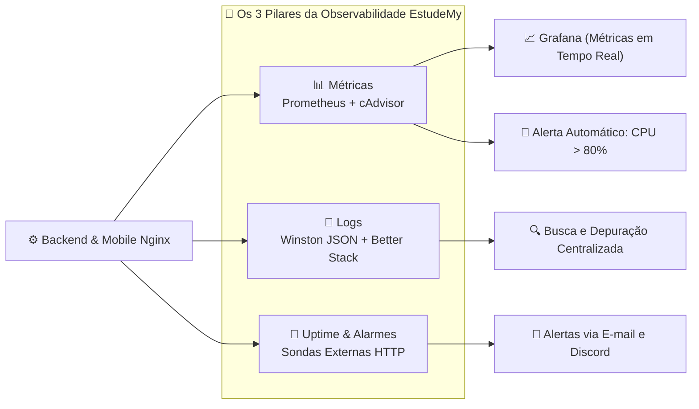
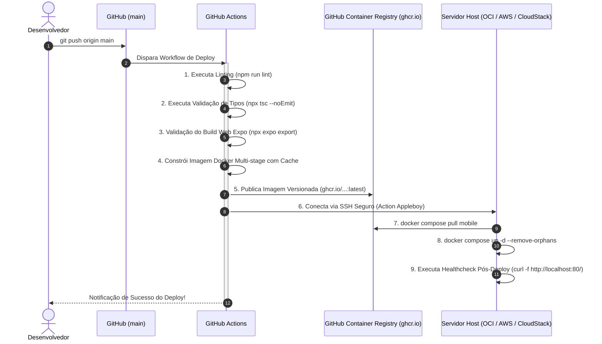

# 🎓 EstudeMy — Plataforma Gamificada de Ensino & Infraestrutura em Nuvem

<p align="center">
  
</p>

<p align="center">
  <strong>Projeto Integrador V — Desenvolvimento de Software Multiplataforma (DSM)</strong><br />
  <strong>Faculdade de Tecnologia de Votorantim (FATEC Votorantim)</strong><br />
  <em>Componente Curricular: Computação em Nuvem I & Segurança no Desenvolvimento de Aplicações</em>
</p>

<p align="center">
  
  
  
  
  
  
  
  
  
  
</p>

---

## 📑 Sumário

1. [Visão Geral do Projeto](#-visão-geral-do-projeto)
2. [Funcionalidades Gamificadas do Aplicativo Mobile](#-funcionalidades-gamificadas-do-aplicativo-mobile)
3. [Arquitetura de Nuvem Multi-Cloud (Cenário TO-BE)](#-arquitetura-de-nuvem-multi-cloud-cenário-to-be)
4. [Matriz Comparativa de Provedores (OCI vs AWS vs Apache CloudStack)](#-matriz-comparativa-de-provedores)
5. [Segurança de Rede e Proteção OWASP (AppSec)](#-segurança-de-rede-e-proteção-owasp-appsec)
6. [Persistência, Rotina de Backup e Recuperação (RPO & RTO)](#-persistência-rotina-de-backup-e-recuperação-rpo--rto)
7. [Observabilidade e Monitoramento em Tempo Real](#-observabilidade-e-monitoramento-em-tempo-real)
8. [Pipeline CI/CD e Gestão de Segredos](#-pipeline-cicd-e-gestão-de-segredos)
9. [Guia de Instalação e Execução Local](#-guia-de-instalação-e-execução-local)
10. [Operação e Deploy na Nuvem](#-operação-e-deploy-na-nuvem)
11. [Estrutura de Pastas do Repositório](#-estrutura-de-pastas-do-repositório)
12. [Documentos e Relatórios do Projeto](#-documentos-e-relatórios-do-projeto)
13. [Equipe e Referências](#-equipe-e-referências)

---

## 📖 Visão Geral do Projeto

A **EstudeMy** é uma plataforma educacional gamificada desenvolvida para transformar o processo de aprendizagem em uma jornada envolvente inspirada em jogos de RPG e dinâmicas de progressão contínua (estilo Duolingo).

O projeto é concebido sob o paradigma **Cloud-Agnostic CaaS sobre IaaS (Contêineres Docker sobre Máquinas Virtuais)**, permitindo portabilidade transparente entre **Oracle Cloud Infrastructure (OCI Free Tier)**, **Amazon Web Services (AWS)** e ambientes on-premises orquestrados por **Apache CloudStack**.

---

## 🎮 Funcionalidades Gamificadas do Aplicativo Mobile

O aplicativo móvel foi desenvolvido em **React Native** com **Expo SDK 57** e navegação por arquivos via **Expo Router**, apresentando uma interface com estética **Retro-Flat Cartoon Premium**:

*   **🗺️ Trilha de Progresso Linear em Zigzag:** Fases sequenciais bloqueadas até a conclusão da fase atual, divididas em unidades temáticas com cores alternadas.
*   **⚔️ Mecânicas de RPG:** Gerenciamento em tempo real de Vidas (❤️), Moedas de Ouro (🪙), Experiência (XP ✨) e sistema de ofensiva (*streak* diário).
*   **🧙 Boneco do Personagem Dinâmico:** O avatar RPG escolhido (Guerreiro, Samurai, Arqueira ou Maga) desloca-se fisicamente pelo mapa acompanhando o nó ativo.
*   **📖 Fases Multimodais:** Suporte a fases do tipo **Conteúdo Teórico** (leitura de materiais) e **Quiz Avaliativo** (perguntas de múltipla escolha com cálculo de pontuação).
*   **👥 Cadastro com Perfis Diferenciados:**
    *   **Aluno:** Formulário ágil com dados cadastrais, data de nascimento e seleção de classe RPG.
    *   **Professor:** Campos profissionais adicionais incluindo Registro Profissional e Titulação acadêmica.
*   **📚 Gestão de Cursos e Lições Salvas:**
    *   Aba **Meus Cursos** separando cursos em andamento de cursos 100% concluídos.
    *   Aba **Lições Salvas** com favoritos persistidos localmente via `expo-secure-store`.
*   **🌐 Suporte Multi-idioma:** Tradução dinâmica com alternância em tempo de execução para **Português (pt-BR)**, **Inglês (en-US)** e **Espanhol (es-ES)**.
*   **🌓 Modo Escuro e Claro:** Temas adaptáveis com alto contraste e acessibilidade visual.

---

## ☁️ Arquitetura de Nuvem Multi-Cloud (Cenário TO-BE)

A arquitetura de produção foi desenhada para superar as limitações do ambiente inicial (*cold starts* do PaaS gratuito, ausência de VPC e banco exposto publicamente):

```mermaid
graph TD
    subgraph Clients["📱 Clientes & Borda Externa"]
        MobileApp["App Mobile (Android / iOS / Expo Go)"]
        WebSPA["Navegador Web (Expo SPA / PWA)"]
        DevOps["Administrador / DevOps (SSH com Chave)"]
    end

    subgraph EdgeLayer["🛡️ Camada de Borda (Edge / WAF)"]
        WAF["WAF & Anti-DDoS (Cloudflare)<br/>Terminação SSL/TLS 1.3 | Anycast DNS"]
    end

    subgraph CloudVCN["☁️ Rede Virtual Privada (CIDR 10.0.0.0/16)"]
        
        subgraph DMZ["🌐 Subnet Pública / DMZ (10.0.1.0/24)"]
            InternetGW["Internet Gateway"]
            Nginx["🛡️ Nginx Alpine Gateway (estudemy_mobile)<br/>Porta 80 (HTTP 301) -> Porta 443 (HTTPS)<br/>HSTS, CSP, Rate Limiting (5 req/m auth)"]
        end

        subgraph PrivateSubnet["🔒 Subnet Privada (10.0.2.0/24) - estudemy_net"]
            NATGateway["NAT Gateway (Saída de Pacotes)"]
            
            subgraph DockerNet["🐳 Rede Docker Bridge (172.28.0.0/16)"]
                Backend["⚙️ Backend API (estudemy_backend :5000)<br/>Node.js 22 LTS + Express 5<br/>Healthcheck em /health a cada 30s"]
                MongoDB["🍃 MongoDB 7.0 Community (:27017)<br/>Autenticação Obrigatória (Least Privilege)"]
                cAdvisor["📦 cAdvisor (:8080)<br/>Métricas de CPU, RAM e I/O de Contêineres"]
                Prometheus["📊 Prometheus (:9090)<br/>Alerta Automático: CPU > 80%"]
                Grafana["📈 Grafana (:3000)<br/>Dashboards em Tempo Real"]
            end

            BlockStorage[("💾 Block Volume Persistente de 200 GB SSD NVMe<br/>Montado em /data/db")]
        end

        subgraph CloudStorage["📦 Camada de Armazenamento de Objetos"]
            ObjectStorage["🗄️ Object Storage Bucket (OCI / AWS S3 / MinIO)<br/>Backup diário às 02h00 | Retenção de 7 dias"]
        end
    end

    Clients -->|HTTPS 443| WAF
    DevOps -->|SSH 22 Restrito| DMZ
    WAF -->|Tráfego Seguro| Nginx
    Nginx -->|Proxy Reverso /api/| Backend
    Nginx -->|Serviço SPA Estático| WebSPA
    Backend -->|Driver Mongoose| MongoDB
    MongoDB -->|Persistência| BlockStorage
    Backend -.->|Métricas /metrics| Prometheus
    cAdvisor -.->|Métricas de Contêiner| Prometheus
    Prometheus -.->|Visualização| Grafana
    DockerNet -.->|mongodump gzip (02h00)| ObjectStorage
    DockerNet -.->|Atualizações via NAT| NATGateway
```

---

## 🧩 Matriz Comparativa de Provedores

A plataforma foi implementada para operar indistintamente em três provedores de nuvem:

| Recurso | Especificação | Oracle Cloud (OCI Always Free) | Amazon Web Services (AWS) | Apache CloudStack (Nuvem Privada FATEC) |
| :--- | :--- | :--- | :--- | :--- |
| **Computação** | 4 vCPUs / OCPUs, 24 GB RAM | `VM.Standard.A1.Flex` (ARM) | EC2 `t4g.2xlarge` | Service Offering: 4 vCPUs / 24 GB |
| **Sistema Operacional** | Ubuntu Server 24.04 LTS | Imagem Canônica OCI | AMI Ubuntu 24.04 LTS | Template Ubuntu 24.04 (`qcow2`) |
| **Armazenamento** | 200 GB SSD NVMe | OCI Block Volume | Amazon EBS `gp3` (200 GB) | Disk Offering SSD (`/dev/vdb`) |
| **Rede Virtual** | CIDR `10.0.0.0/16` | Virtual Cloud Network (VCN) | Amazon VPC | **Isolated Guest Network** |
| **Borda / Firewall** | Portas 80, 443 e 22 | Security Lists + Internet GW | Security Groups + Internet GW | **Virtual Router (VR) com Port Forwarding** |
| **Subnet Privada** | Portas 5000 e 27017 isoladas | Private Subnet + NAT GW | Private Subnet + NAT GW | Rede Convidada sem Port Forwarding |
| **Object Storage** | S3-Compatible API | OCI Object Storage Bucket | Amazon S3 Standard | **MinIO On-Premises** |
| **Provisionamento** | Shell Script + Docker Compose | Cloud-Init / OCI CLI | Cloud-Init / AWS CLI | **Cloud-Init (User Data) / CloudMonkey** |

---

## 🔒 Segurança de Rede e Proteção OWASP (AppSec)

A infraestrutura adota a estratégia de **defesa em profundidade** implementando contramedidas específicas contra as principais ameaças do OWASP Top 10:

*   **Segmentação Rígida de Portas:**
    *   **Porta 443 (HTTPS Público):** Tráfego seguro obrigatório com terminação TLS 1.3 e cifras criptográficas modernas.
    *   **Porta 80 (HTTP Público):** Redirecionamento permanente **HTTP 301** para HTTPS.
    *   **Porta 22 (SSH Administrativo):** Restrita a IPs de gerência autorizados e autenticação exclusiva por chave pública.
    *   **Portas 5000 (API) e 27017 (MongoDB):** 100% isoladas na Subnet Privada, sem rotas de acesso direto pela internet.
*   **Cabeçalhos de Segurança HTTP no Nginx ([`nginx.prod.conf`](file:///c:/Users/Alunos/Documents/GitHub/EstudeMy-Mobile/nginx.prod.conf)):**
    *   `Strict-Transport-Security`: HSTS ativo por 1 ano (`max-age=31536000; includeSubDomains; preload`).
    *   `Content-Security-Policy (CSP)`: Restrição rigorosa de fontes de scripts, imagens e conexões, prevenindo XSS (RC02).
    *   `X-Frame-Options: DENY`: Prevenção contra ataques de sequestro de clique (*Clickjacking*).
    *   `X-Content-Type-Options: nosniff`: Bloqueio contra farejamento de tipos MIME (*MIME Sniffing*).
*   **Rate Limiting por IP (Mitigação de Brute Force e DDoS - RC04/RC08):**
    *   Rotas de autenticação (`/api/auth/`): limite de **5 requisições por minuto** com *burst* de 5.
    *   Rotas gerais da API (`/api/`): limite de **30 requisições por segundo** com *burst* de 20.
    *   Conexões simultâneas: máximo de 30 conexões por IP.
*   **Bloqueio contra Directory Traversal e Arquivos Sensíveis (RC11):**
    *   Expressões contendo `../` ou `%2e%2e` são barradas com código HTTP 403.
    *   Arquivos `.env`, `.git`, `.yml` e scripts `.sh` são terminantemente bloqueados com código HTTP 404.
*   **Princípio do Menor Privilégio no MongoDB ([`scripts/mongo-init.js`](file:///c:/Users/Alunos/Documents/GitHub/EstudeMy-Mobile/scripts/mongo-init.js)):**
    *   Criação de usuário dedicado `estudemy_app` com escopo restrito de leitura e escrita exclusivamente na base `estudemy`.

---

## 💾 Persistência, Rotina de Backup e Recuperação (RPO & RTO)

*   **RPO (Recovery Point Objective):** **24 Horas** (perda máxima tolerada em caso de desastre).
*   **RTO (Recovery Time Objective):** **< 15 Minutos** (tempo total de recuperação do serviço).
*   **Volume de Dados:** Mapeamento do diretório `/data/db` do MongoDB para um **Block Volume de 200 GB SSD NVMe**.
*   **Rotina Automatizada de Backup ([`scripts/backup.sh`](file:///c:/Users/Alunos/Documents/GitHub/EstudeMy-Mobile/scripts/backup.sh)):**
    *   Executada diariamente às **02h00 UTC** via agendamento cron:
        ```crontab
        0 2 * * * /opt/estudemy/scripts/backup.sh >> /opt/estudemy/logs/backup_cron.log 2>&1
        ```
    *   Executa `mongodump` com compressão nativa gzip no formato de arquivo datado:
        `estudemy_backup_YYYYMMDD_HHMMSS.archive.gz`
    *   Valida tamanho e integridade física do arquivo gerado.
    *   Sincroniza automaticamente o arquivo com o bucket de **Object Storage** (OCI Object Storage, AWS S3 ou MinIO).
    *   Aplica **política de retenção de 7 dias**, expurgando backups antigos do disco local.
*   **Recuperação de Desastre ([`scripts/restore.sh`](file:///c:/Users/Alunos/Documents/GitHub/EstudeMy-Mobile/scripts/restore.sh)):**
    *   Permite restaurar a base integralmente com comando único:
        ```bash
        sudo ./scripts/restore.sh
        ```
    *   Executa `mongorestore --gzip --archive` e realiza um *smoke test* validando a contagem de coleções restauradas em menos de 15 minutos.

---

## 📈 Observabilidade e Monitoramento em Tempo Real

A observabilidade foi implementada sob os **três pilares** da confiabilidade de software:



1.  **Métricas de Infraestrutura e Contêineres:**
    *   **Prometheus 2.51 LTS ([`monitoring/prometheus/prometheus.yml`](file:///c:/Users/Alunos/Documents/GitHub/EstudeMy-Mobile/monitoring/prometheus/prometheus.yml)):** Coleta métricas de 10s em 10s da API (`/metrics`), do cAdvisor (`:8080`) e do Nginx (`/stub_status`).
    *   **Regra de Alerta Automático ([`monitoring/prometheus/alert.rules.yml`](file:///c:/Users/Alunos/Documents/GitHub/EstudeMy-Mobile/monitoring/prometheus/alert.rules.yml)):** Dispara alarme caso o consumo de CPU de qualquer contêiner da stack ultrapasse **80% por 2 minutos contínuos**.
    *   **Grafana 10.4 ([`monitoring/grafana/dashboards/estudemy_overview.json`](file:///c:/Users/Alunos/Documents/GitHub/EstudeMy-Mobile/monitoring/grafana/dashboards/estudemy_overview.json)):** Painel pré-provisionado exibindo status dos nós (UP/DOWN), consumo de CPU/RAM em tempo real e tráfego de rede.
2.  **Logs Estruturados:**
    *   Formato JSON padronizado com nível (`info`, `warn`, `error`), timestamp UTC, rota e código de resposta.
    *   Ingestão centralizada em nuvem no **Better Stack Logs**.
3.  **Monitoramento de Uptime:**
    *   Endpoint dedicado de saúde `/health` consultado a cada 30 segundos com reinicialização automática do contêiner em caso de falha.

---

## 🔄 Pipeline CI/CD e Gestão de Segredos

O pipeline automatizado foi implementado através do GitHub Actions no arquivo [`.github/workflows/deploy.yml`](file:///c:/Users/Alunos/Documents/GitHub/EstudeMy-Mobile/.github/workflows/deploy.yml):



*   **Gestão de Segredos:** Nenhum segredo ou chave privada é versionado no Git. Todos os dados confidenciais são injetados em tempo de execução via **GitHub Actions Secrets** (`CLOUD_SERVER_HOST`, `CLOUD_SSH_PRIVATE_KEY`, `JWT_SECRET`, `MONGO_APP_PASSWORD`).

---

## 💻 Guia de Instalação e Execução Local

### Pré-requisitos
*   **Node.js 22 LTS** ou superior instalado.
*   **Docker Engine 26.x+** e **Docker Compose Plugin v2**.
*   Aplicativo **Expo Go** instalado no smartphone (opcional para teste físico).

### 1. Clonar o Repositório e Instalar Dependências
```bash
git clone https://github.com/estudemy/estudemy-mobile.git
cd estudemy-mobile
npm install
```

### 2. Configurar Variáveis de Ambiente Locais
Crie um arquivo `.env` na raiz do projeto com base no modelo:
```env
EXPO_PUBLIC_API_URL=http://localhost:5000
```

### 3. Modos de Execução

#### Opção A: Executar com Metro Bundler (Desenvolvimento com Hot Reload)
```bash
npx expo start -c
```
*   Pressione **`w`** para abrir no navegador web.
*   Pressione **`a`** para abrir no emulador Android.
*   Escaneie o QR Code no smartphone com o app **Expo Go**.

#### Opção B: Executar a Stack Completa Localmente com Docker (Dev Mode)
```bash
npm run docker:dev
```
*   Inicia MongoDB 7, Backend API e Metro Bundler com montagem de volumes e *live reload*.

#### Opção C: Executar a Stack de Produção em Nuvem com Observabilidade
```bash
# 1. Gerar certificados SSL locais autoassinados para teste
bash ./scripts/init-ssl.sh selfsigned

# 2. Subir a stack completa de produção
npm run docker:prod
```
*   **Aplicação Web:** [http://localhost](http://localhost) (redireciona para HTTPS na porta 443)
*   **Backend Health:** [http://localhost:5000/health](http://localhost:5000/health)
*   **Painel Grafana:** [http://localhost:3000](http://localhost:3000) (Login: `admin` / `estudemy_grafana_pass_2026`)
*   **Métricas Prometheus:** [http://localhost:9090](http://localhost:9090)

---

## 🚀 Operação e Deploy na Nuvem

### 1. Provisionamento Automático de uma Máquina Virtual Host (Ubuntu 24.04 LTS)
No servidor recém-criado na **Oracle Cloud (Always Free ARM)**, **AWS (EC2)** ou **Apache CloudStack**:

```bash
# Executar script de provisionamento automatizado como root
sudo ./scripts/setup-cloud-vm.sh
```
O script atualiza o sistema operacional, instala o Docker 26.x, configura as regras de firewall UFW, cria os diretórios em `/opt/estudemy`, registra o cron de backup (`0 2 * * *`) e habilita o serviço de inicialização automática `systemctl enable estudemy`.

### 2. Executar a Bateria de Testes de Conformidade do Ambiente
Para certificar que a infraestrutura atende a todos os critérios de rede, segurança e banco de dados:
```bash
npm run cloud:test
```
O script executa 10 testes automatizados cobrindo conectividade da SPA, cabeçalhos CSP, proteção anti-directory traversal, autenticação no MongoDB, resolução DNS interna e disponibilidade do Prometheus/Grafana.

### 3. Acionar Backup Manual
```bash
npm run cloud:backup
```

---

## 📂 Estrutura de Pastas do Repositório

```text
EstudeMy-Mobile/
├── .github/
│   └── workflows/
│       ├── ci.yml                    # Pipeline de validação estática e testes
│       └── deploy.yml                # Pipeline completo de build, GHCR e deploy remoto
├── assets/                           # Ícones, ilustrações RPG e splash screens
├── cloudstack/
│   └── user-data.sh                  # Script Cloud-Init para provisionamento no Apache CloudStack
├── monitoring/
│   ├── prometheus/
│   │   ├── prometheus.yml            # Configuração de raspagem de métricas
│   │   └── alert.rules.yml           # Regra de alarme para CPU > 80% e queda de nós
│   └── grafana/
│       ├── dashboards/
│       │   └── estudemy_overview.json# Dashboard visual com gauges e séries temporais
│       └── provisioning/             # Auto-provisionamento de datasources e pastas
├── scripts/
│   ├── backup.sh                     # Rotina de backup com mongodump gzip e Object Storage
│   ├── restore.sh                    # Rotina de restauração e Disaster Recovery (RTO < 15m)
│   ├── mongo-init.js                 # Inicialização de usuário e índices do MongoDB
│   ├── setup-cloud-vm.sh             # Automação de setup de host Ubuntu 24.04 LTS
│   ├── init-ssl.sh                   # Gerenciamento de certificados SSL/TLS Let's Encrypt
│   ├── test-cloud-environment.sh     # Bateria de testes de validação do ambiente de nuvem
│   └── reset-project.js              # Script utilitário do Expo
├── src/                              # Código-fonte do aplicativo React Native
│   ├── app/                          # Rotas baseadas em arquivos (Expo Router)
│   ├── components/                   # Componentes reutilizáveis com estética retro-flat
│   ├── config/                       # Configurações globais e cliente Axios (api.config.ts)
│   ├── contexts/                     # AuthContext, ThemeContext, LocaleContext
│   ├── locales/                      # Dicionários de tradução (pt-BR, en-US, es-ES)
│   ├── services/                     # Serviços de integração com a API REST
│   └── utils/                        # Utilitários de log e concorrência segura
├── .env.example                      # Exemplo de variáveis para desenvolvimento
├── .env.production.example           # Exemplo seguro de variáveis para produção em nuvem
├── CLOUDSTACK.md                     # Guia completo de implantação no Apache CloudStack
├── IMPLEMENTACAO_NUVEM.md            # Documentação técnica consolidada da Entrega 2
├── PLANEJAMENTO_IMPLANTACAO_NUVEM.md # Relatório de planejamento e análise da Entrega 1
├── Dockerfile                        # Multi-stage Dockerfile (Compilação Expo Web + Nginx)
├── docker-compose.yml                # Compose padrão para desenvolvimento local
├── docker-compose.dev.yml            # Extensão do Compose para Metro Bundler com live reload
├── docker-compose.prod.yml           # Compose de produção com stack completa de observabilidade
├── nginx.conf                        # Configuração padrão do Nginx com proxy e headers
├── nginx.prod.conf                   # Configuração de produção com SSL 443 e redirecionamento 80
├── package.json                      # Dependências e scripts npm integrados
└── tsconfig.json                     # Configurações de tipagem estrita do TypeScript
```

---

## 📑 Documentos e Relatórios do Projeto

*   📘 **[IMPLEMENTACAO_NUVEM.md](file:///c:/Users/Alunos/Documents/GitHub/EstudeMy-Mobile/IMPLEMENTACAO_NUVEM.md):** Relatório técnico completo de implantação com evidências e matriz de conformidade com os 14 itens do edital de Computação em Nuvem I.
*   ☁️ **[CLOUDSTACK.md](file:///c:/Users/Alunos/Documents/GitHub/EstudeMy-Mobile/CLOUDSTACK.md):** Manual detalhado de provisionamento de nuvem privada no Apache CloudStack 4.22 LTS com Virtual Router e MinIO.
*   📋 **[PLANEJAMENTO_IMPLANTACAO_NUVEM.md](file:///c:/Users/Alunos/Documents/GitHub/EstudeMy-Mobile/PLANEJAMENTO_IMPLANTACAO_NUVEM.md):** Diagnóstico inicial do ambiente (*AS-IS*) e planejamento da Entrega 1.
*   🛡️ **[relatorio_riscos_imprimir.html](file:///c:/Users/Alunos/Documents/GitHub/EstudeMy-Mobile/relatorio_riscos_imprimir.html):** Relatório de Análise de Riscos de Segurança (AppSec / OWASP Top 10) formatado para impressão em A4.

---

## 👥 Equipe e Referências

### Corpo Docente e Orientação
*   **Professor de Computação em Nuvem I:** Prof. Me. Benir Falcão Pistille
*   **Professor de Segurança no Desenvolvimento de Aplicações:** Prof. Me. Benir Falcão Pistille
*   **Orientador Geral do Projeto Integrador V:** Prof. Dr. Milton Roman de Brito

### Instituição
*   **Faculdade de Tecnologia de Votorantim (FATEC Votorantim)**
*   **Centro Estadual de Educação Tecnológica Paula Souza (CEETEPS)**
*   **Curso:** Curso Superior de Tecnologia em Desenvolvimento de Software Multiplataforma (DSM)
*   **Ano Letivo:** 2026

### Referências Bibliográficas Normativas (ABNT NBR 6023:2018)
1.  **APACHE SOFTWARE FOUNDATION.** *Apache CloudStack Documentation (Release 4.22 LTS)*. Disponível em: <https://docs.cloudstack.apache.org/>. Acesso em: out. 2026.
2.  **ORACLE CORPORATION.** *Oracle Cloud Infrastructure Documentation — Networking & Compute Always Free*. Disponível em: <https://docs.oracle.com/en-us/iaas/>. Acesso em: out. 2026.
3.  **AMAZON WEB SERVICES.** *AWS Well-Architected Framework: Reliability and Security Pillars*. Seattle: AWS, 2025. Disponível em: <https://aws.amazon.com/architecture/well-architected/>. Acesso em: out. 2026.
4.  **MONGODB INC.** *MongoDB Production Notes and Security Hardening Guide*. MongoDB 7.0 Manual. Disponível em: <https://www.mongodb.com/docs/manual/administration/production-notes/>. Acesso em: out. 2026.
5.  **DOCKER INC.** *Docker and Docker Compose Best Practices for Production*. Disponível em: <https://docs.docker.com/develop/develop-images/dockerfile_best-practices/>. Acesso em: out. 2026.
6.  **FATEC VOTORANTIM.** *Manual de Diretrizes do Projeto Interdisciplinar V — DSM*. Votorantim: Centro Paula Souza, 2026.
