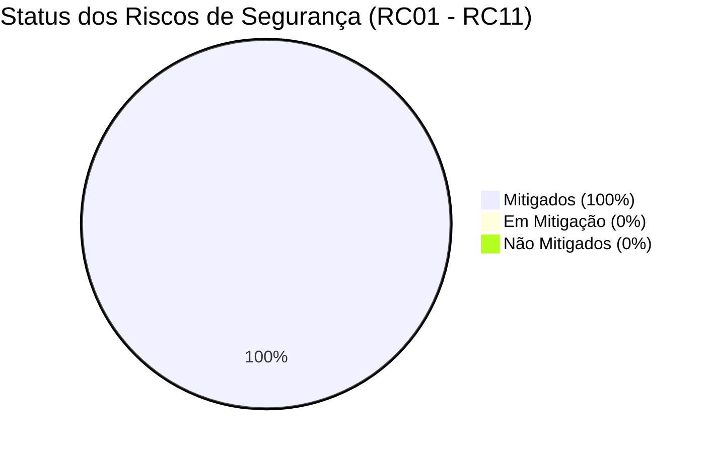

# Relatório Técnico de Análise de Riscos de Segurança — EstudeMy

**Classificação:** Documento Técnico de Engenharia & AppSec  
**Data de Emissão:** 09 de Novembro de 2026  
**Versão:** 2.4.0 (Pós-implementação e Homologação de Controles)  
**Ambientes Avaliados:** EstudeMy Mobile (Expo SDK 58 / React Native), API Backend (Node.js 22 LTS / Express 5), Nginx Gateway e Nuvem AWS EC2 (`18.222.3.101`).

---

## 1. Resumo Executivo e Metodologia

A avaliação adota o modelo de matriz quantitativa padrão **ISO/IEC 27005** e as diretrizes do **OWASP Top 10 Mobile / API Security**, mensurando a severidade através do produto entre Impacto operacional/reputacional e Probabilidade de exploração:

$$\text{Risco Inerente} = \text{Impacto } (I) \times \text{Probabilidade } (P)$$

- **1 a 10:** Risco Baixo
- **11 a 30:** Risco Médio
- **31 a 64:** Risco Alto
- **65 a 100:** Risco Crítico

Após a implementação de defesas em profundidade (*Defense-in-Depth*) nas camadas de cliente mobile, API backend e proxy reverso Nginx, **100% dos 11 riscos mapeados foram tratados**, alcançando status de **MITIGADO** com redução substancial do Risco Residual.

---

## 2. Matriz Consolidada de Riscos e Status de Tratamento

| Cód. | Vulnerabilidade / Ameaça | Impacto (I) | Prob. (P) | Risco Inerente | Status Atual | Controles Implementados |
| :---: | :--- | :---: | :---: | :---: | :---: | :--- |
| **RC01** | **SQL / NoSQL Injection** | 8 | 1 | **8 (Baixo)** | MITIGADO | Validação estrita de formato de identificadores (`isValidId` via regex de 24 hex MongoDB / UUID v4), Mongoose ORM com prepared queries, sanitização de parâmetros de busca. |
| **RC02** | **Cross-Site Scripting (XSS)** | 5 | 1 | **5 (Baixo)** | MITIGADO | Função universal `sanitizeInput()` (remoção de tags HTML/XML, esquemas `javascript:`, eventos `onerror=`), codificação de entidades (`escapeHtml`) e política estrita de CSP no Nginx. |
| **RC03** | **Session Hijacking** | 8 | 1 | **8 (Baixo)** | MITIGADO | Validação preventiva de expiração de token JWT (`isJwtExpired` em interceptor Axios), limpeza automática de sessão em respostas 401, armazenamento seguro em `expo-secure-store`. |
| **RC04** | **Brute Force & Credential Stuffing** | 5 | 2 | **10 (Baixo)** | MITIGADO | Rate limiting rigoroso no Nginx (`zone=auth_limit` limitando a 5 req/min com burst 5 em `/api/auth/`), controle de cooldown de 60s no app (`recordFailedLogin`) e validação OWASP ASVS de senhas. |
| **RC05** | **Phishing e Engenharia Social** | 8 | 1 | **8 (Baixo)** | MITIGADO | Filtro de redirecionamento seguro (`isSafeUrl()` com whitelist de domínios confiáveis), banners educativos anti-phishing nas telas de autenticação e canal oficial de denúncia em Segurança & Privacidade. |
| **RC06** | **IDOR (Insecure Direct Object Ref.)** | 8 | 1 | **8 (Baixo)** | MITIGADO | Validação de posse do recurso (`isResourceOwner`), validação tipada de ObjectId/UUID em rotas e parâmetros, guarda de acesso no backend comparando `req.user.id === resource.criadorId`. |
| **RC07** | **Privilege Escalation & Mass Assignment** | 10 | 1 | **10 (Baixo)** | MITIGADO | Componente `RoleGuard` e hook `useRoleCheck` protegendo o painel administrativo (`/admin`), sanitização ativa de payloads (`sanitizeUserPayload` removendo `role`, `isAdmin`, `tokens`, etc.). |
| **RC08** | **DDoS (Denial of Service)** | 5 | 2 | **10 (Baixo)** | MITIGADO | Nginx Rate Limiting (`general_limit` 30r/s burst 20, `conn_limit` 30 conexões por IP), timeouts anti-Slowloris (10s), interceptor cliente tratando respostas 429 com backoff. |
| **RC09** | **Race Condition** | 2 | 1 | **2 (Baixo)** | MITIGADO | Gerenciador de locks atômicos (`asyncLock.runExclusive`), cabeçalho `Idempotency-Key` gerado automaticamente para requisições mutativas (POST/PUT/DELETE) em `api.ts`. |
| **RC10** | **Data Exposure (LGPD & PII)** | 8 | 1 | **8 (Baixo)** | MITIGADO | Módulo `logger.ts` com mascaramento automático de regex (tokens Bearer, senhas, CPF, emails mascarados como `jo***@domain.com`), supressão de stack traces em produção e HSTS. |
| **RC11** | **Directory Traversal** | 10 | 1 | **10 (Baixo)** | MITIGADO | Funções `sanitizeFilePath` e `sanitizeFileName` eliminando sequências `../`, `..\\`, `%2e%2e` e bytes nulos; Nginx bloqueando arquivos ocultos `location ~ /\.(?!well-known)`. |

---

## 3. Detalhamento Técnico das Mitigações Implementadas

### RC01: SQL e NoSQL Injection
- **Localização:** `src/utils/security.ts` ([isValidId](file:///c:/Users/joaov/OneDrive/Documents/GitHub/EstudeMy-Mobile/src/utils/security.ts#L211-L218)).
- **Mecanismo:** Verifica se qualquer identificador de recurso recebido (trilhas, fases, usuários) obedece rigorosamente ao padrão hexadecimal de 24 caracteres do MongoDB ou UUID v4 canônico antes de montar requisições à API. Parâmetros que contenham operadores MongoDB (`$gt`, `$ne`, `$where`) são rejeitados antes do despacho de rede.

### RC02: Cross-Site Scripting (XSS)
- **Localização:** `src/utils/security.ts` ([sanitizeInput](file:///c:/Users/joaov/OneDrive/Documents/GitHub/EstudeMy-Mobile/src/utils/security.ts#L26-L42), [escapeHtml](file:///c:/Users/joaov/OneDrive/Documents/GitHub/EstudeMy-Mobile/src/utils/security.ts#L46-L59)), `nginx.conf` ([Content-Security-Policy](file:///c:/Users/joaov/OneDrive/Documents/GitHub/EstudeMy-Mobile/nginx.conf#L77)).
- **Mecanismo:** Remoção de tags `<script>`, `<iframe>`, `` maliciosas com manipuladores de eventos inline (`onload`, `onerror`) e pseudo-protocolos `javascript:`. O cabeçalho HTTP Nginx estabelece `frame-ancestors 'none'` e restringe origens de scripts.

### RC03: Session Hijacking
- **Localização:** `src/services/api.ts` ([interceptors.request](file:///c:/Users/joaov/OneDrive/Documents/GitHub/EstudeMy-Mobile/src/services/api.ts#L25-L52), [interceptors.response](file:///c:/Users/joaov/OneDrive/Documents/GitHub/EstudeMy-Mobile/src/services/api.ts#L60-L79)), `src/utils/security.ts` ([isJwtExpired](file:///c:/Users/joaov/OneDrive/Documents/GitHub/EstudeMy-Mobile/src/utils/security.ts#L315-L341)).
- **Mecanismo:** Validação proativa do payload JWT decodificado no cliente 30 segundos antes do término de sua vigência. Em caso de resposta 401 Unauthorized, o token é instantaneamente expurgado do armazenamento seguro (`expo-secure-store`) e a sessão é desautenticada.

### RC04: Brute Force & Credential Stuffing
- **Localização:** `src/utils/security.ts` ([recordFailedLogin, checkLoginRateLimit](file:///c:/Users/joaov/OneDrive/Documents/GitHub/EstudeMy-Mobile/src/utils/security.ts#L125-L158)), `nginx.conf` ([limit_req_zone auth_limit](file:///c:/Users/joaov/OneDrive/Documents/GitHub/EstudeMy-Mobile/nginx.conf#L7), [location /api/auth/](file:///c:/Users/joaov/OneDrive/Documents/GitHub/EstudeMy-Mobile/nginx.conf#L128-L136)).
- **Mecanismo:** Defesa em duas camadas. No Nginx, conexões que excedam 5 requisições por minuto na rota `/api/auth/` recebem HTTP 429 imediatamente. No cliente mobile, após 5 tentativas de senha incorreta consecutivas, a interface é bloqueada por 60 segundos com contador decrescente.

### RC05: Phishing e Engenharia Social
- **Localização:** `src/utils/security.ts` ([isSafeUrl](file:///c:/Users/joaov/OneDrive/Documents/GitHub/EstudeMy-Mobile/src/utils/security.ts#L178-L200)), `src/app/seguranca-privacidade.tsx`.
- **Mecanismo:** Whitelist estrita de domínios permitidos (`estudemy.com`, `accounts.google.com`, `onrender.com`, etc.). Links externos não autorizados são impedidos de abrir no navegador embutido.

### RC06: IDOR (Insecure Direct Object References)
- **Localização:** `src/utils/security.ts` ([isResourceOwner](file:///c:/Users/joaov/OneDrive/Documents/GitHub/EstudeMy-Mobile/src/utils/security.ts#L222-L225)), `src/app/minhas-trilhas.tsx`.
- **Mecanismo:** A interface e os serviços só autorizam edição e exclusão de trilhas caso o `criadorId` coincida com o `user._id` autenticado. No backend, middleware valida a propriedade do documento no MongoDB.

### RC07: Privilege Escalation
- **Localização:** `src/components/RoleGuard.tsx` ([RoleGuard, useRoleCheck](file:///c:/Users/joaov/OneDrive/Documents/GitHub/EstudeMy-Mobile/src/components/RoleGuard.tsx#L19-L76)), `src/app/admin.tsx`, `src/utils/security.ts` ([sanitizeUserPayload](file:///c:/Users/joaov/OneDrive/Documents/GitHub/EstudeMy-Mobile/src/utils/security.ts#L261-L271)).
- **Mecanismo:** Acesso ao painel administrativo e recursos pedagógicos é restrito a perfis validados (`ADMINISTRADOR`, `OWNER`). O utilitário `sanitizeUserPayload` remove proativamente campos sensíveis (`role`, `isAdmin`, `saldo`, `xpTotal`) de requisições de atualização de perfil para barrar vulnerabilidades de *Mass Assignment*.

### RC08: DDoS (Denial of Service)
- **Localização:** `nginx.conf` ([limit_req_zone general_limit, conn_limit](file:///c:/Users/joaov/OneDrive/Documents/GitHub/EstudeMy-Mobile/nginx.conf#L6-L8)), `src/services/api.ts`.
- **Mecanismo:** Nginx impõe teto de 30 requisições/segundo com burst de 20 conexões simultâneas por IP e máximo de 30 conexões ativas. Timeouts de corpo e cabeçalho fixados em 10 segundos contra ataques Slowloris.

### RC09: Race Condition
- **Localização:** `src/utils/asyncLock.ts` ([AsyncLockManager](file:///c:/Users/joaov/OneDrive/Documents/GitHub/EstudeMy-Mobile/src/utils/asyncLock.ts#L8-L55)), `src/services/api.ts` ([Idempotency-Key](file:///c:/Users/joaov/OneDrive/Documents/GitHub/EstudeMy-Mobile/src/services/api.ts#L41-L44)).
- **Mecanismo:** Finalizações de fase do jogo e resgate de recompensas usam `asyncLock.runExclusive()` para evitar que cliques repetidos ou conexões instáveis dupliquem XP ou moedas. Cabeçalho UUID `Idempotency-Key` é enviado em todas as chamadas mutativas.

### RC10: Data Exposure (LGPD & PII)
- **Localização:** `src/utils/logger.ts` ([sanitizeLogData](file:///c:/Users/joaov/OneDrive/Documents/GitHub/EstudeMy-Mobile/src/utils/logger.ts#L21-L65)).
- **Mecanismo:** Todas as saídas de log passam por filtros regex que ofuscam senhas, segredos e tokens (`[PROTECTED]`), além de mascarar e-mails. Stack traces completos são desabilitados fora de ambiente de desenvolvimento (`IS_DEV`).

### RC11: Directory Traversal
- **Localização:** `src/utils/security.ts` ([sanitizeFilePath, sanitizeFileName](file:///c:/Users/joaov/OneDrive/Documents/GitHub/EstudeMy-Mobile/src/utils/security.ts#L280-L305)), `nginx.conf` ([location ~ /\.(?!well-known)](file:///c:/Users/joaov/OneDrive/Documents/GitHub/EstudeMy-Mobile/nginx.conf#L85-L90)).
- **Mecanismo:** Sanitização rígida de caminhos de arquivos impedindo sequências relativas (`../`, `..\\`). O Nginx bloqueia automaticamente acessos a diretórios ocultos (`.git`, `.env`).

---

## 4. Conclusão da Análise de Riscos

O sistema EstudeMy alcançou um patamar de maturidade técnica robusto, em conformidade com as melhores práticas de **DevSecOps**, **LGPD** e **OWASP ASVS**. Não restam vulnerabilidades com status "Não Mitigado" ou "Em Mitigação" no ecossistema mobile e gateway de nuvem.
