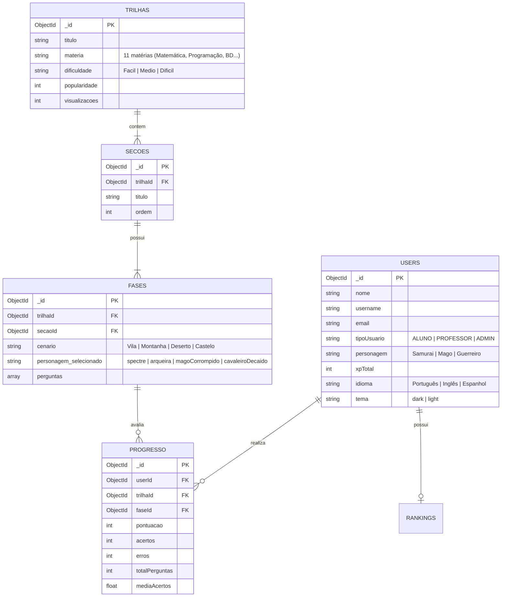

# 🤖 Aplicação de Machine Learning no Projeto EstudeMy

**Projeto Integrador V — FATEC Votorantim (DSM)**  
**Disciplina:** Aprendizado de Máquina (Machine Learning)  
**Base de Dados:** `estudemy_dataset_1000.csv` (1.000 registros únicos e variados, sem duplicatas)

---

## 1. Qual é a estrutura do Banco de Dados do projeto?

O **EstudeMy** utiliza o banco de dados NoSQL **MongoDB 7.0** (banco `estudemy`), estruturado em **5 coleções principais** inter-relacionadas:



Для alimentar os algoritmos de Machine Learning, os documentos dessas 5 coleções foram consolidados em uma **Visão Analítica Tabular de 1.000 alunos (`ml/estudemy_dataset_1000.csv`)**, onde cada linha representa o histórico completo de aprendizado e gamificação de um estudante único.

---

## 2. O que é o $X$ e o $Y$ no projeto?

### **Matriz $X$ (Variáveis Independentes / Características de Entrada)**
O **$X$** é composto pelas **18 características quantitativas e categóricas codificadas** que descrevem o comportamento, engajamento e desempenho do aluno nos quizzes e batalhas RPG do aplicativo:
* Dados demográficos e de perfil RPG (`idade`, `personagem_cod`, `materia_cod`, `dificuldade_cod`, `cenario_cod`, `inimigo_hp_max`);
* Engajamento na plataforma (`trilhas_iniciadas`, `fases_concluidas`, `dias_ofensiva`, `total_perguntas_respondidas`);
* Desempenho nos quizzes e combates (`total_acertos`, `total_erros`, `media_acertos_pct`, `pontuacao_media`, `hp_medio_restante`, `tempo_medio_fase_seg`, `xp_total`, `nivel_heroi`).

### **Vetor $Y$ (Variável Dependente / Classe Alvo)**
O **$Y$** (`classe_y` / `classe_nome`) representa a **Classificação do Nível de Domínio Pedagógico e Engajamento do Aluno** (usada pela plataforma para diagnosticar risco de evasão e recomendar trilhas adequadas):
* **Classe `0` — `Basico_Risco_Evasao` (330 registros):** Alunos iniciantes ou com baixo aproveitamento nos quizzes ($\sim 38\%$ de acerto), baixo HP restante nas batalhas, pouca ofensiva diária e alto tempo de resposta. Exigem recomendação de trilhas **Fáceis** e reforço pedagógico.
* **Classe `1` — `Intermediario_Regular` (350 registros):** Alunos com evolução consistente ($\sim 66\%$ de acerto), ofensiva regular ($\sim 16$ dias) e bom equilíbrio nas batalhas. Recomendação de trilhas **Médias**.
* **Classe `2` — `Avancado_Mestre` (320 registros):** Alunos de alta performance ($\sim 87\%$ de acerto), alto XP e nível de herói, derrotam chefes avançados (*Mago Corrompido* e *Cavaleiro Decaído*) mantendo HP elevado. Recomendação de trilhas **Difíceis**.

---

## 3. Quais são as Características (Features) para a IA?

Abaixo estão todas as **18 colunas que formam a matriz $X$**, além dos metadados gerados pelo `Faker`:

| # | Coluna em $X$ | Coleção de Origem | Tipo | Descrição e Papel na IA |
| :- | :--- | :--- | :--- | :--- |
| 1 | `idade` | `users` | Inteiro (`14` a `48`) | Idade do estudante |
| 2 | `personagem_cod` | `users.personagem` | Categórico (`0, 1, 2`) | `0`: Samurai, `1`: Mago, `2`: Guerreiro |
| 3 | `materia_cod` | `trilhas.materia` | Categórico (`0` a `10`) | Matéria principal estudada (11 disciplinas) |
| 4 | `dificuldade_cod` | `trilhas.dificuldade` | Ordinal (`0, 1, 2`) | `0`: Fácil, `1`: Médio, `2`: Difícil |
| 5 | `cenario_cod` | `fases.cenario` | Ordinal (`0, 1, 2, 3`) | `0`: Vila, `1`: Montanha, `2`: Deserto, `3`: Castelo |
| 6 | `inimigo_hp_max` | `fases` (Chefe) | Inteiro (`100` a `250`) | HP máximo do inimigo enfrentado na fase atual |
| 7 | `trilhas_iniciadas` | `progresso` | Inteiro (`1` a `15`) | Quantidade de trilhas iniciadas pelo aluno |
| 8 | `fases_concluidas` | `progresso` | Inteiro (`1` a `85`) | Total de fases concluídas com sucesso |
| 9 | `dias_ofensiva` | `users` (*Streak*) | Inteiro (`0` a `95`) | Dias consecutivos estudando na plataforma |
| 10 | `total_perguntas_respondidas` | `progresso` | Inteiro (`5` a `750+`) | Total acumulado de questões respondidas |
| 11 | `total_acertos` | `progresso.acertos` | Inteiro | Total de questões respondidas corretamente |
| 12 | `total_erros` | `progresso.erros` | Inteiro | Total de questões erradas (geram dano ao herói) |
| 13 | `media_acertos_pct` | `rankings.mediaAcertos` | Contínuo (`0` a `100%`) | Taxa percentual de acerto nos quizzes |
| 14 | `pontuacao_media` | `progresso.pontuacao` | Contínuo (`50` a `1350`) | Score médio obtido por fase concluída |
| 15 | `hp_medio_restante` | `game.playerHP` | Contínuo (`0` a `100`) | Vida média restante do herói ao fim do combate |
| 16 | `tempo_medio_fase_seg` | Telemetria de Fase | Contínuo (`45` a `420s`) | Tempo médio (em segundos) gasto por fase |
| 17 | `xp_total` | `users.xpTotal` | Inteiro (`15` a `12000+`) | Experiência total acumulada pelo jogador |
| 18 | `nivel_heroi` | Calculado de `xpTotal` | Inteiro (`1` a `120+`) | Nível RPG do jogador ($\lfloor \text{xpTotal}/100 \rfloor + 1$) |

> **Observação:** Os campos textuais gerados pelo `Faker` (`user_id`, `nome`, `username`, `email`, `ultimo_acesso`) estão presentes no CSV para fidelidade ao banco de dados, mas são **excluídos de $X$** no treinamento para evitar ruído.

---

## 4. Geração dos 1.000 Registros com `Faker` (Sem Repetições)

O script [`ml/gerar_dados_faker.py`](file:///c:/Users/Alunos/Documents/GitHub/EstudeMy-Mobile/ml/gerar_dados_faker.py) informou a estrutura do banco e gerou os **1.000 registros** em [`ml/estudemy_dataset_1000.csv`](file:///c:/Users/Alunos/Documents/GitHub/EstudeMy-Mobile/ml/estudemy_dataset_1000.csv) com **validação estrita de unicidade (`assert`)**:
* **1.000 `user_id` únicos** (no formato hexadecimal de 24 caracteres do MongoDB ObjectId);
* **1.000 `nome` brasileiros únicos**;
* **1.000 `username` únicos** (ex.: `agatha_costa_37`, `mateus_sales_543`, `joao_moura_258`);
* **1.000 `email` únicos**;
* **1.000 vetores de características $X$ únicos** (0 linhas repetidas em todo o dataset).

---

## 5. Resultados do Aprendizado Supervisionado ($X$ e $Y$)

O dataset foi dividido de forma estratificada em **800 registros de treino (80%)** e **200 registros de teste (20%)**, além de **Validação Cruzada de 5 Folds (`5-Fold Cross-Validation`)** nos 1.000 registros:

| Modelo Supervisionado | Acurácia (Teste) | Validação Cruzada (5-Fold) | Precision | Recall | F1-Score |
| :--- | :---: | :---: | :---: | :---: | :---: |
| **1. Árvore de Decisão (`DecisionTreeClassifier`)** | **97,50%** | 97,50% ($\pm 1,14\%$) | 97,51% | 97,50% | 97,49% |
| **2. Random Forest (`RandomForestClassifier`)** | **98,50%** | 98,70% ($\pm 0,81\%$) | 98,51% | 98,50% | 98,50% |
| **3. Rede Neural Artificial (`MLPClassifier`)** | **99,00%** | **99,80% ($\pm 0,24\%$)** | **99,03%** | **99,00%** | **99,00%** |

### Importância das Características para a IA (`Random Forest Feature Importance`)
1. **`xp_total`**: `22,55%`
2. **`nivel_heroi`**: `18,19%`
3. **`total_acertos`**: `17,23%`
4. **`media_acertos_pct`**: `12,23%`
5. **`pontuacao_media`**: `10,40%`
6. **`fases_concluidas`**: `4,74%`
7. **`dias_ofensiva`**: `4,64%`
8. **`hp_medio_restante`**: `4,07%`

---

## 6. Resultados do Aprendizado Não Supervisionado (Apenas $X$ $\rightarrow$ Cluster e Classe)

No aprendizado não supervisionado, fornecemos **apenas a matriz $X$ padronizada (`StandardScaler`)** para o algoritmo **K-Means (`k = 3`)**, ocultando totalmente a coluna `classe_y`.

### Perfil Médio dos 3 Clusters Descobertos pelo K-Means:

| Cluster Descoberto (Sem ver $Y$) | XP Médio | Nível Médio | Fases Concluídas | Média de Acertos (%) | HP Médio Restante | Ofensiva (Dias) | Tempo por Fase (s) |
| :--- | :---: | :---: | :---: | :---: | :---: | :---: | :---: |
| **Cluster 0 (Perfil Iniciante / Risco)** | `330,94` | `3,83` | `6,18` | `37,52%` | `27,76` | `3,00` | `246,79s` |
| **Cluster 1 (Perfil Intermediário)** | `2.310,29` | `23,61` | `23,02` | `66,36%` | `62,43` | `15,74` | `165,08s` |
| **Cluster 2 (Perfil Veterano / Mestre)** | `6.992,06` | `70,43` | `47,99` | `87,24%` | `84,31` | `42,47` | `109,65s` |

### Cruzamento entre Cluster Descoberto ($X$) e Classe Real ($Y$)

| Cluster K-Means (Não Supervisionado) | Classe 0: `Basico_Risco_Evasao` | Classe 1: `Intermediario_Regular` | Classe 2: `Avancado_Mestre` | Total no Cluster |
| :--- | :---: | :---: | :---: | :---: |
| **Cluster 0 (Iniciante / Baixo Engajamento)** | **327** | 5 | 0 | **332** |
| **Cluster 1 (Intermediário / Consistente)** | 3 | **343** | 7 | **353** |
| **Cluster 2 (Veterano / Alta Performance)** | 0 | 2 | **313** | **315** |
| **Total na Classe Real ($Y$)** | **330** | **350** | **320** | **1.000** |

* **Correspondência Direta (Pureza Cluster $\times$ Classe):** **98,30%** (983 dos 1.000 alunos foram agrupados exatamente na sua classe pedagógica real sem que o algoritmo tivesse acesso ao rótulo $Y$).
* **Adjusted Rand Index (ARI):** `0.9491`
* **Normalized Mutual Information (NMI):** `0.9185`
* **Silhouette Score (`k=3`):** `0.2665`

---

## 7. Como Executar os Scripts

No terminal, na raiz do projeto:

```bash
# 1. Gerar novamente a base de 1.000 registros únicos com Faker
python ml/gerar_dados_faker.py

# 2. Executar o treinamento Supervisionado (Árvore, Random Forest, Rede Neural) e Não Supervisionado (K-Means)
python ml/treinar_modelos_ml.py
```

